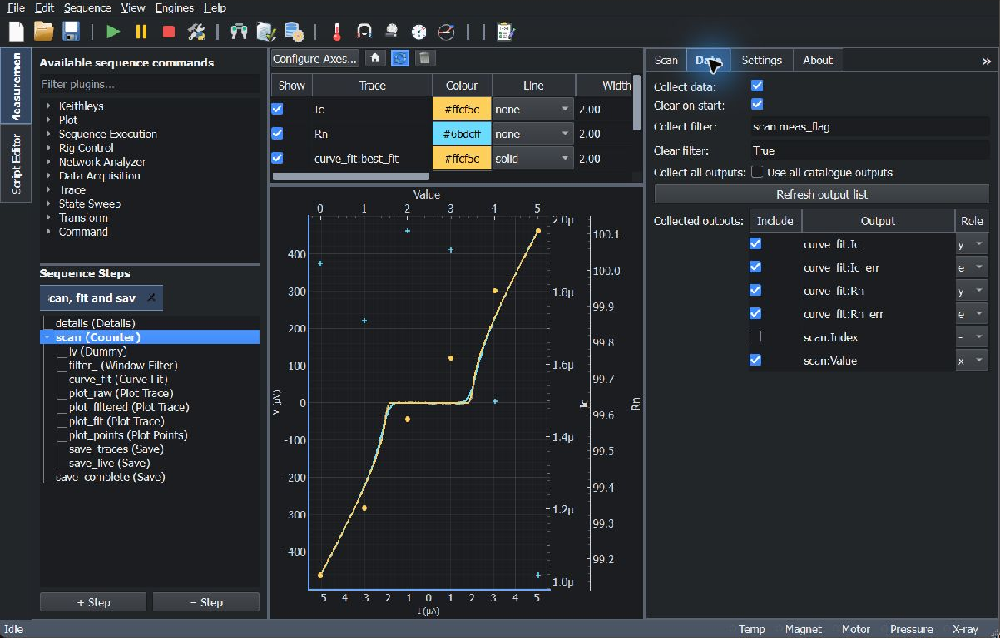
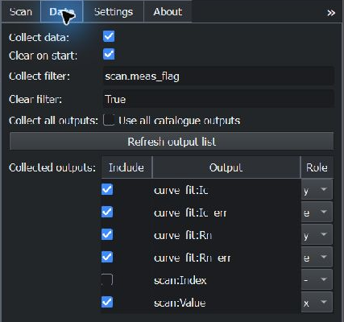
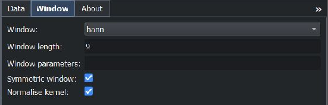
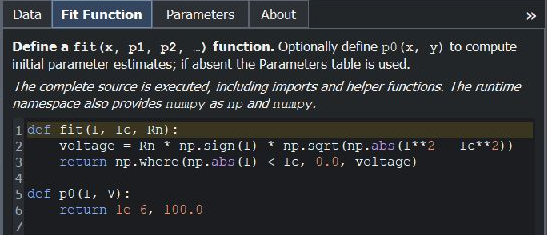
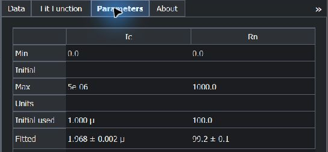
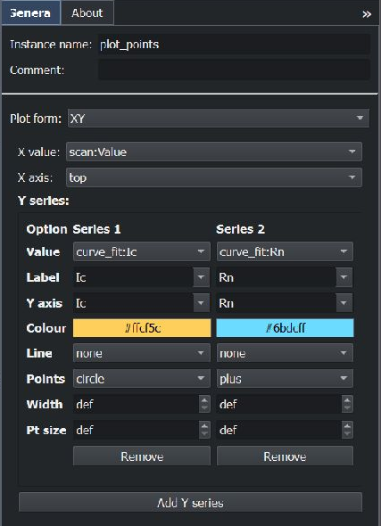
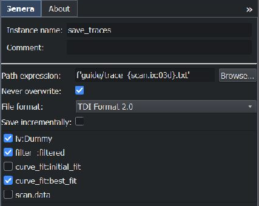
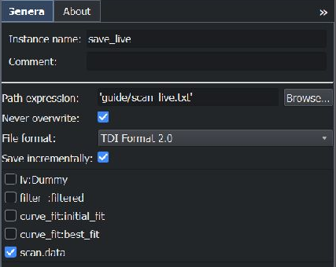

Collecting, fitting and saving data
===================================

This walkthrough extends the basic measurement in :doc:`usage` with a scan,
selected scalar outputs, filtering, curve fitting, live plots, and data files.
The same data-selection and saving controls are available for state sweeps.

A complete example
------------------

Download :download:`the scan, fit and save example <examples/scan_fit_save.json>`
and load it with **File → Open Sequence…** on the **Measurement** tab.
Custom toolbar buttons can also load predefined sequences: if your installation
has a button for this workflow, clicking it opens the configured sequence.
Such buttons are configured locally and may differ between installations.

The downloadable example uses a hardware-free **Counter** scan with six values,
0 through 5, and the **Dummy** I-V trace. The simulated critical current changes
with the scan value. It follows the acquisition/filter/fit/plot/save pattern of
a field or temperature experiment without requiring a controller connection.
The required **User**, **Sample**, and **Project** fields are already filled in
with demonstration values.

The sequence tree is organised as follows:

.. code-block:: text

    details
    scan (Counter)
        iv (Dummy)
        filter_ (Window Filter)
        curve_fit (Curve Fit)
        plot_raw (Plot Trace)
        plot_filtered (Plot Trace)
        plot_fit (Plot Trace)
        plot_points (Plot Points)
        save_traces (Save)
        save_live (Save)
    save_complete (Save)

Each scan point acquires a trace, processes it, fits the model, plots the
current results, and executes the child Save steps. The scan then appends its
collected row. After all six points, ``save_complete`` writes the finished
scan table. Choose a default data directory in **Edit → Preferences…** before
running: this example writes into a ``guide`` subdirectory there.

   Completed example with six fitted-parameter points. The last I-V trace and
   fit use the bottom/left axes; the parameter points use the top and extra
   right-side axes.

Choosing what a scan or sweep collects
--------------------------------------

Select the parent scan or sweep and open its **Data** tab:

1. Enable **Collect data** to accumulate a table of scalar readings.
2. In **Collected outputs**, tick **Include** for each output you want to
   retain. Add measurement and processing steps first so their outputs appear;
   use **Refresh output list** after changing the available outputs.
3. Set each included output's **Role**. In this example, collect
   ``curve_fit:Ic``, ``curve_fit:Rn`` and their ``_err`` uncertainties.
   ``scan:Value`` is selected as the independent variable.
4. Keep **Clear on start** enabled for a fresh table on each execution of the
   scan. Disable it only when you intend to accumulate successive executions.

This is the parent state scan/sweep's Data tab. A trace plugin's **Scan** tab
instead chooses the points within one acquired trace. To collect a trace's
scalar statistics, enable **Report channel average and standard deviation
outputs** on that trace's Scan tab, then select the new mean/std outputs in
the parent's Data table. Monitor readings and fitted parameters can be
selected from the same catalogue.

   Select numerical outputs independently of what is plotted or saved.
   The unchecked ``scan:Index`` output is excluded from the selected readings.

.. list-table:: Roles in the collected table
   :header-rows: 1
   :widths: 15 85

   * - Role
     - Meaning
   * - ``x``
     - Independent coordinate. Only one selected readback can have this role.
   * - ``y``
     - Dependent measurement or fitted parameter.
   * - ``d``
     - Additional data channel.
   * - ``e``
     - Uncertainty channel.
   * - ``-``
     - Auxiliary column retained without a primary plotting role.

The **Include** checkbox determines whether a reading is collected; ``-``
does not exclude it. **Use all catalogue outputs** selects all available
outputs and assigns automatic roles. Adjust the individual rows when you want
a smaller table or explicit roles.

By default the commanded scan/sweep value supplies ``x``. Assigning ``x`` to
a readback instead uses that measured value and retains the commanded value
in a separate ``state`` column. The table also includes ``iteration`` and
``stage`` bookkeeping columns. It is available directly as ``scan.data`` in
the trace selectors for plotting and saving; no conversion step is needed.

**Collect filter** is a Python condition applied in addition to the point's
measurement flag. The default ``scan.meas_flag`` collects measurement points,
not travel-only points. **Clear filter** controls whether a requested clear
actually clears the table; its default is ``True``. Replace ``scan`` in these
expressions with your own step's instance name. Selecting outputs does not
execute their producers: place the measurement and fitting steps inside the
scan/sweep so their results are current when the row is collected.

Filtering and fitting a trace
-----------------------------

Place **Window Filter** after the acquiring trace. On its **Data** tab choose
``iv:Dummy`` and the voltage column. On **Window**, select the window type and
length. The example uses a symmetric nine-point ``hann`` window with
**Normalise kernel** enabled, giving a weighted local average without changing
the overall signal scale. Compare the filtered and raw traces when choosing
the length: smoothing can also change narrow features.

   The filtered trace is published as ``filter_:filtered``. The raw ``iv:Dummy``
   trace remains available for comparison and saving.

Place **Curve Fit** after the filter. On its **Data** tab choose
``filter_:filtered`` and the column to fit. On **Fit Function**, define a
``fit(x, p1, p2, ...)`` function or load one from the fitting function library.
The argument after ``x`` names each fitted parameter. An optional ``p0(x, y)``
function computes the starting values; otherwise use the **Initial** row on
the **Parameters** tab. The example fits ``Ic`` and ``Rn``:

.. code-block:: python

    def fit(I, Ic, Rn):
        voltage = Rn * np.sign(I) * np.sqrt(np.abs(I**2 - Ic**2))
        return np.where(np.abs(I) < Ic, 0.0, voltage)

    def p0(I, V):
        return 1e-6, 100.0

   NumPy is available as ``np`` in the fit function's runtime namespace.

On **Parameters**, set lower and upper bounds and inspect **Initial used**
and **Fitted** after a run. With ``p0`` defined, **Initial used** shows the
values it returned. **Calculate initial parameter trace** and
**Calculate best fit trace** make comparison traces available to Plot Trace.

   Values are from the last acquisition; they change across the scan.

Fitted scalar outputs such as ``curve_fit:Ic`` and ``curve_fit:Ic_err`` appear
in the value selectors and collection table. Trace outputs include
``curve_fit:initial_fit`` and ``curve_fit:best_fit`` when enabled. A failed fit
is logged and produces NaN results, so check the fitted values and messages
before interpreting the plotted parameters.

Plot Points and Plot Trace
--------------------------

.. list-table:: Choosing the plotting command
   :header-rows: 1
   :widths: 25 40 35

   * - Command
     - Input
     - Behaviour
   * - **Plot Trace**
     - An acquired trace, transformed trace, fitted curve, or collected table.
     - Displays the table's arrays; later calls update the same named series.
   * - **Plot Points**
     - Current scalar outputs, such as scan value and fitted parameters.
     - Appends one point per configured series each time the command executes.

The example's three Plot Trace commands display ``iv:Dummy``,
``filter_:filtered``, and ``curve_fit:best_fit``. These show the current
acquisition as the scan progresses. To display the completed collected table,
add a Plot Trace after the parent scan and select ``scan.data`` and its desired
column instead.

Place **Plot Points** inside the scan, after **Curve Fit**, so it appends the
parameters from the current acquisition. Choose **XY** as **Plot form**,
``scan:Value`` as **X value**, and add Y series for ``curve_fit:Ic`` and
``curve_fit:Rn``. Set their labels, colours and point styles in the series
table. **Add Y series** adds another scalar output to the same command.

   Separate axes let parameters with different units and scales share a plot.
   This example uses ``top`` for the scan coordinate and ``Ic``/``Rn`` for the
   additional Y axes, leaving bottom/left for the I-V traces.

Plotting and data collection are independent. Plot Points draws scalar
readings; enabling **Collect data** retains those readings in a table that
Save can write. Saving selects the underlying trace tables, not a screenshot
of the plot.

Saving complete traces
----------------------

Add **Save** after the steps that produce the required traces. Select the
trace checkboxes, a **File format**, and a **Path expression**. Leave
**Save incrementally** off for a complete snapshot on each execution.

   ``save_traces`` writes the raw, filtered and best-fit I-V columns together
   in one file per scan point. The collected scan table is unchecked here.

The expression ``f'guide/trace_{scan.ix:03d}.txt'`` gives
``trace_000.txt``, ``trace_001.txt``, and so on. For a fixed filename, use a
quoted string such as ``'guide/results.txt'``. Relative paths use the default
data directory from Preferences; parent directories are created as needed.
Keep **Never overwrite** enabled to add a numeric suffix when a destination
already exists.

**TDI Format 2.0** saves tab-delimited numerical columns and a metadata
snapshot, including the sequence configuration and evaluated outputs.
**NeXus/HDF5** is also available when its optional dependency is installed.
Use separate Save steps for full acquisition traces and the collected scan
table so their different row counts remain easy to interpret.

Saving a growing scan or sweep table
------------------------------------

Inside the scan/sweep, add another Save step after acquisition and processing.
Select only ``scan.data``, enable **Save incrementally**, and choose a stable
path such as ``'guide/scan_live.txt'``. Each execution updates the same file
with newly available rows. A path that changes on every iteration creates
separate destinations instead of one growing file.

   The incremental command remembers its chosen destination for the current
   run, including any suffix selected to avoid overwriting an older file.

.. important::

   Automatic collection occurs **after all child steps** for a scan/sweep
   point. A Save child therefore sees rows collected on preceding iterations;
   it does not yet see the current point's row. In this six-point example,
   ``scan_live.txt`` contains five rows when the loop ends.

For a complete file using only the sequence editor, put a separate Save
**after the parent scan/sweep**, select ``scan.data``, and leave incremental
saving off. The example's ``save_complete`` writes all six rows to
``'guide/scan_complete.txt'``.

To finish the *same incremental file* when developing a Python script, add
one final call to the **same Save instance** after the generated loop has
completed successfully, **inside the outer try block, before its finally
cleanup**:

.. code-block:: python

    save_live()  # after the scan loop, before the generated finally block

Do not rerun the whole sequence to flush the file: a new run clears the
scan table when **Clear on start** is enabled and starts a new Save session.
Calling the Save instance from the console after cleanup also requires a new
connection/configuration, which starts a new save session; keep the final call
before cleanup to retain the original incremental destination.
The incremental setting tracks additional rows; use complete-trace saving
for repeated acquisitions that replace a fixed-length table.

For a one-off check, use **Run Selection…** or :kbd:`Shift+F5` on the parent
scan so its acquisition, processing, plotting and Save children are included.
The following ``save_complete`` step is outside that selection: select it too
if you want the final complete snapshot. See :ref:`running-selected-steps`.
