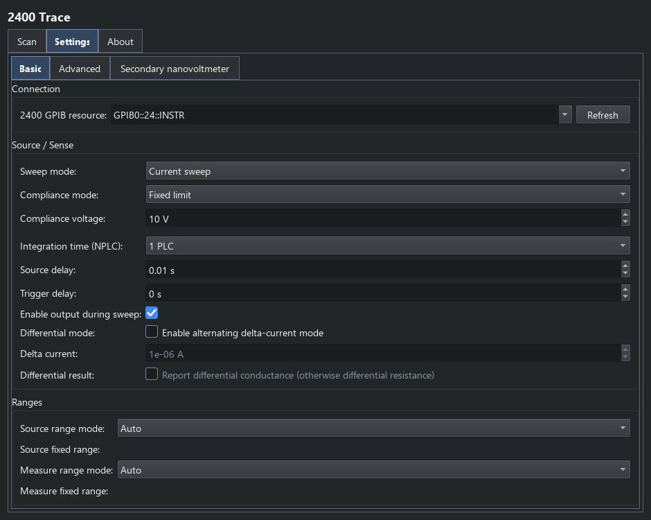
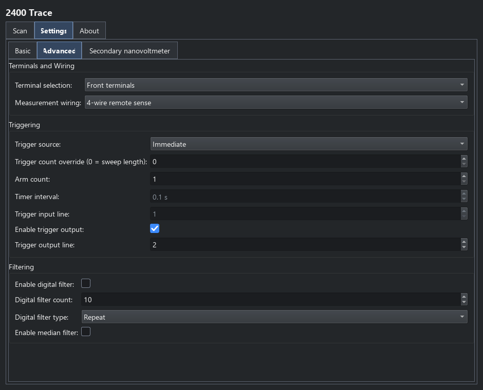

2400 trace setup
================

See :doc:`2400 IV Trace </_generated/sequence_commands/plugin-k2400_dc_iv>`
for settings, supported auxiliary meters and result columns. Use the
:doc:`2400 point scan <keithley_point_commands>` when measurements must run as
child steps at each held source level.

Basic settings
--------------

   Basic settings for the buffered 2400 trace.

Check that the chosen terminals and sense wiring match the rig. Set compliance
for the connected sample before running.

Wiring and triggering
---------------------

   Wiring, trigger and filter settings.

Use :doc:`keithley_triggers` to choose trigger routing for the connected
instruments. A secondary nanovoltmeter needs the dedicated Trigger Link
handshake, with integration and filtering that fit the intended cadence.
