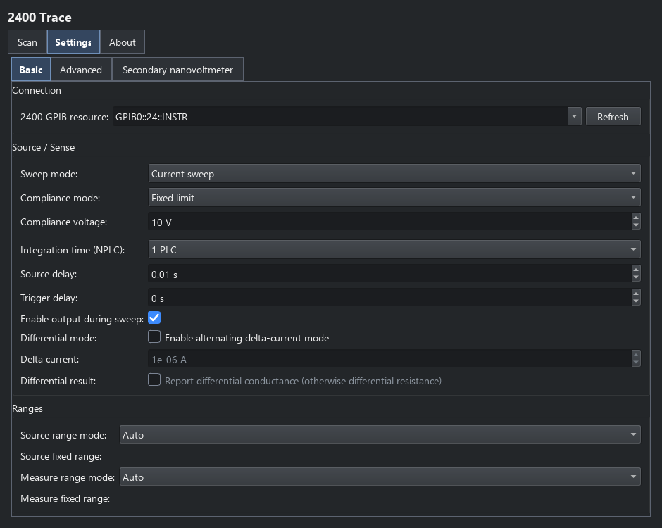
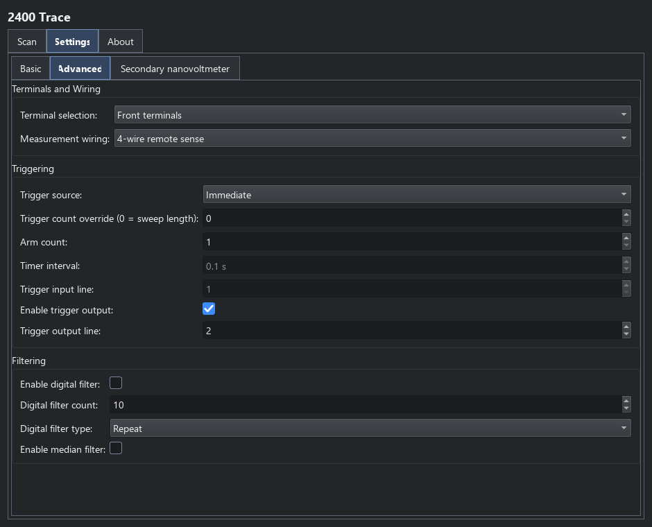

2400 trace
==========

Choose **2400 IV Trace** from the Keithleys catalogue for a buffered current-
or voltage-source sweep using a Keithley 2400-series source-meter. **Scan**
supplies arbitrary source points;
configuration programs them as a LIST sweep. The instrument's trigger model
and buffer acquire the whole curve before results are retrieved.
For measurement children at each held source level, use the 2400 point scan
in :doc:`keithley_point_commands`.

Basic settings
--------------

**Settings > Basic** selects the GPIB resource, current/voltage source mode,
compliance, integration, delays, output-enable behaviour and source/sense
ranges. In current-source mode the direct compliance limit is a voltage; in
voltage-source mode it is a current. Resistance-derived compliance is also
available.

   Basic settings for the buffered 2400 trace.

The default configuration uses current sourcing, fixed 10 V compliance, front
terminals and four-wire remote sense. Check wiring and compliance for the
connected sample before running; the screenshot is an example configuration.

Advanced settings and triggering
--------------------------------

**Advanced** selects front/rear terminals, two/four-wire measurement, digital
or median filtering, and immediate, bus, external, Trigger Link or timer
routing. Trigger input/output lines, counts and timer intervals must match
the experiment. Trigger output is enabled by default on line 2. The complete
routing overview is in :doc:`keithley_triggers`.

   Wiring, trigger and filter settings.

**Secondary nanovoltmeter** optionally enables a separate GPIB-connected
Keithley 182 or 2182A, with a column prefix and supported integration, range
and filtering options. It uses a Trigger Link handshake with the SMU and adds
prefixed voltage, response and power columns to ``IV``. Enabling it determines
the acquisition handshake; see :doc:`keithley_triggers` rather than combining
it with an unrelated free-running trigger scheme.

Results and differential acquisition
------------------------------------

The ordinary ``IV`` trace contains programmed source ``x``, measured
``Current`` (A), ``Voltage`` (V), derived ``Resistance`` (ohms), ``Power`` (W)
and ``Timestamp`` (s). The programmed source column is distinct from measured
current/voltage. Plot Trace selects the response channels; Save writes the
result table as described in :doc:`data_workflows`.

In current-source mode, **Differential mode** alternates positive/negative
**Delta current** offsets about the nominal scan values. It requires at least
three points and a positive delta current. The returned source axis remains
nominal; reduced neighbouring readings supply voltage and differential
resistance, or ``Conductance`` in siemens when selected. Endpoint responses
use the nearest interior reduction. Power uses delta current times the reduced
voltage change. This is not the native 6221 Pulse Delta mode.

Lifecycle and Python access
---------------------------

Configuration prepares the list, trigger model and buffer. Each measurement
starts a fresh acquisition and reads the buffered results. With the normal
output-enable setting, output stays enabled until disconnect; cleanup disables
output and releases the SMU and any owned secondary-meter session.

For attributes and console use, find ``Keithley2400SweepPlugin`` in the
:doc:`plugin API reference <api/plugins>`.
Return to :doc:`keithley_meters` for the other trace modes and point commands.
