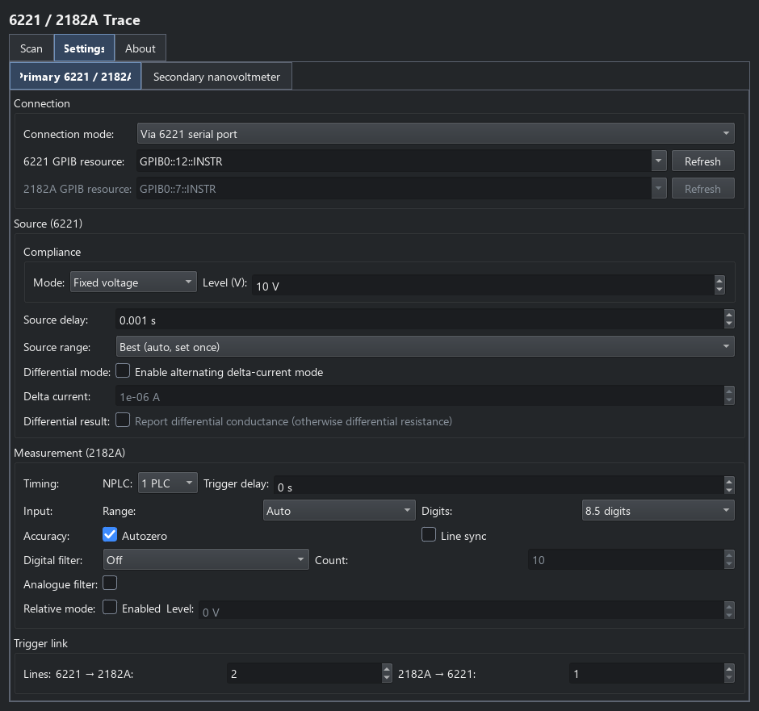
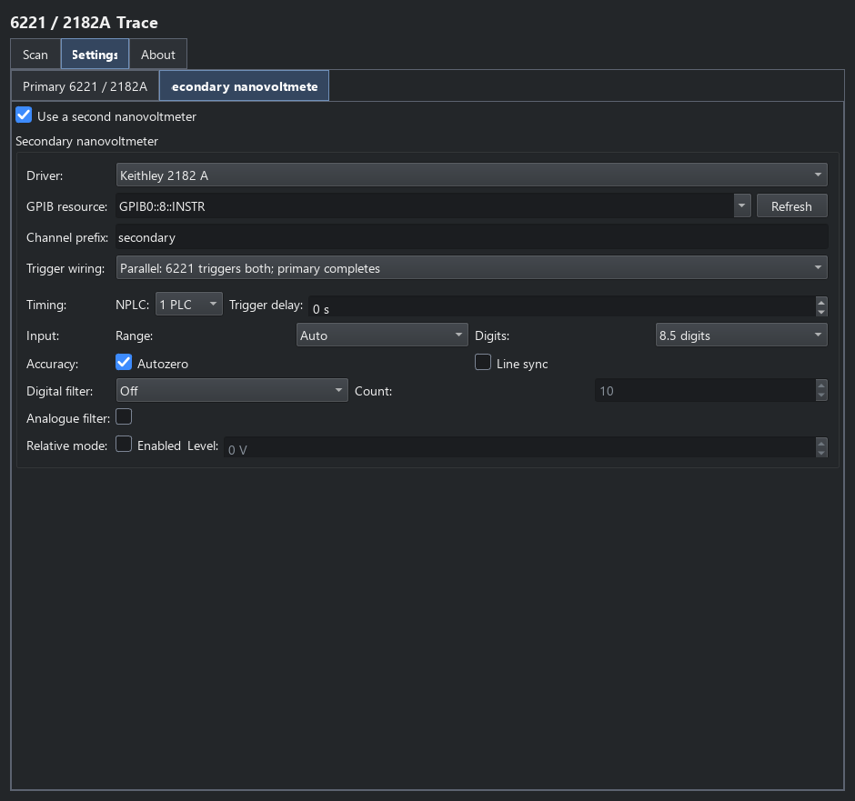

6221/2182A trace
================

Choose **6221/2182 IV Trace** from the Keithleys catalogue for a current-driven
I-V curve with a Keithley 6221 and primary 2182A nanovoltmeter. The scan
generator supplies a current list in
amperes; Trigger Link handshaking coordinates the source and buffered readings.
This is a complete trace acquisition. Use :doc:`keithley_point_commands` when
the source must hold each DC level while child steps run.

Connections and settings
------------------------

On **Settings > Primary 6221 / 2182A**, select the 6221 GPIB resource and choose
how to reach the 2182A: through the 6221 serial relay, or through its own GPIB
resource. Serial relay carries commands; Trigger Link still carries the
measurement handshake.

   Primary source and meter configuration. The secondary meter is enabled for
   this illustrated configuration, but connects only when the sequence runs.

Choose fixed-voltage compliance or the per-point limit derived from
``abs(current) * compliance_resistance``. Configure the settling delay and
current-range policy: **Best** selects a range for the whole list, **Auto**
permits per-point range changes, and a fixed range holds the selected value.
The meter controls cover NPLC integration, voltage range, digits, trigger
delay, autozero, line synchronisation, digital/analogue filters and relative
mode. Runtime expressions are evaluated by the acquisition configuration,
not by the scan preview.

The source-to-meter and meter-to-source trigger lines must match the wiring.
Defaults are line 2 from the 6221 to the 2182A and line 1 for the return
handshake. See :doc:`keithley_triggers` before changing them.

Optional second nanovoltmeter
-----------------------------

**Secondary nanovoltmeter** enables an independently connected Keithley 182
or 2182A. Set its GPIB resource, column prefix, supported integration/range/
filter settings and trigger routing. Controls follow the selected driver.

   Secondary-meter configuration for the ordinary 6221/2182A trace.

In **parallel** routing, both meters receive each source trigger; the primary
returns the handshake. The secondary must finish before the next trigger.
The configuration warns when estimated integration/filter time is too long.
In **daisy-chain** routing, the primary triggers the secondary, and the
secondary's completion advances the source. This waits for both conversions.
See the routing guide for the separate trigger lines.

Scan and results
----------------

**Scan** selects the current generator. The ``IV`` trace has programmed current
``x`` (A), ``V`` (V), ``R`` (ohms) and ``P`` (W). Ordinary-mode resistance is
``V / I`` and is NaN at zero current; power is ``I * V``. Enabling the second
meter adds prefixed voltage, response and power columns to the same table.
Plot Trace and Save consume this complete result; see :doc:`data_workflows`.

**Differential mode** alternates positive and negative **Delta current** offsets
around the nominal scan currents. It needs at least three points and a
positive delta current. Returned ``x`` values remain nominal; neighbouring
readings supply reduced voltage and differential ``R`` or ``G`` (siemens),
depending on the resistance/conductance choice. Power uses delta current
times the reduced voltage change. Endpoint responses use the nearest interior
reduction. This is separate from :doc:`keithley_pulse_delta`.

Acquisition and cleanup
-----------------------

The plugin programs the current list and retrieves buffered meter readings
after each sweep. It owns the source, primary-meter connection or serial
relay, and any enabled secondary-meter session. Disconnect attempts to disable
the source output and close those sessions. Do not use the buffered sweep as
a substitute for a held-DC point scan.

For the Python API and console attributes, find ``Keithley6221_2182APlugin``
in the :doc:`plugin API reference <api/plugins>`.
Return to :doc:`keithley_meters` to compare the available acquisition modes.
