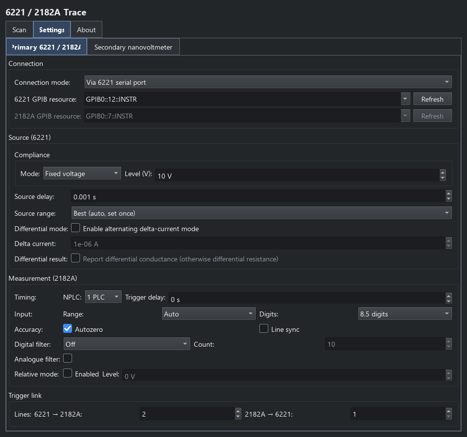
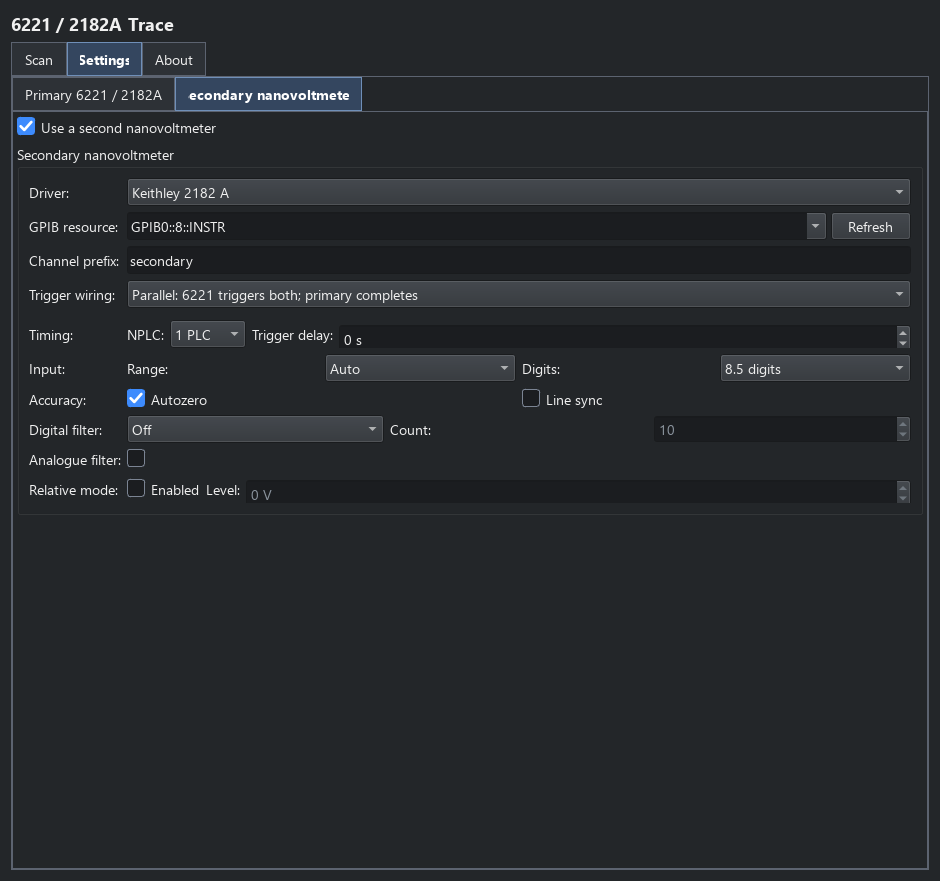

6221/2182A trace setup
======================

See :doc:`6221/2182 IV Trace </_generated/sequence_commands/plugin-k6221_dc_iv>`
for the sequence step's settings and result columns. Use the examples below
when configuring the primary and optional secondary meters.

Primary meter
-------------

   Primary source and meter configuration. The secondary meter is enabled for
   this illustrated configuration, but connects only when the sequence runs.

Choose the meter's command path for the wiring on your rig. The 6221 serial
relay uses the source's GPIB connection for commands to the primary 2182A.
Both command paths still use Trigger Link for the measurement handshake. See
:doc:`keithley_triggers` for line assignments and secondary-meter wiring.

Optional second nanovoltmeter
-----------------------------

   Secondary-meter configuration for the ordinary 6221/2182A trace.

Check the conversion time of both meters when choosing parallel or daisy-chain
routing. The :doc:`triggering guide <keithley_triggers>` explains how to avoid
a secondary conversion overrunning the next trigger.

Use :doc:`keithley_point_commands` when the source must hold each DC level
while child steps run. Use :doc:`data_workflows` for processing and saving a
complete acquired curve.
