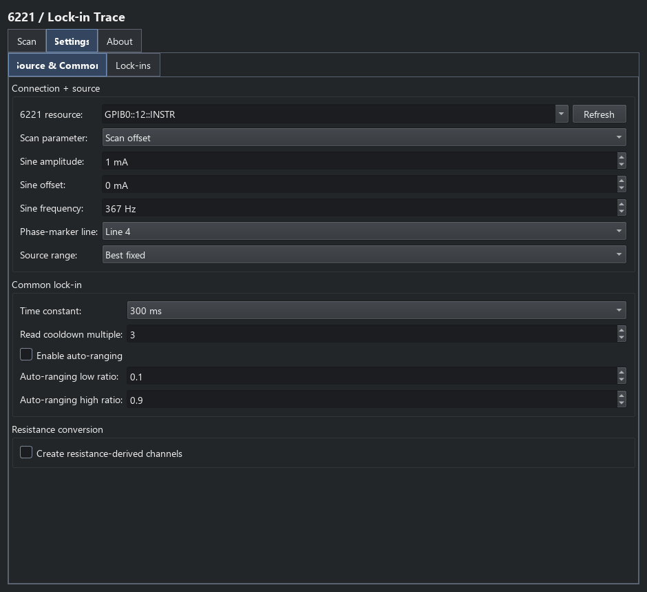
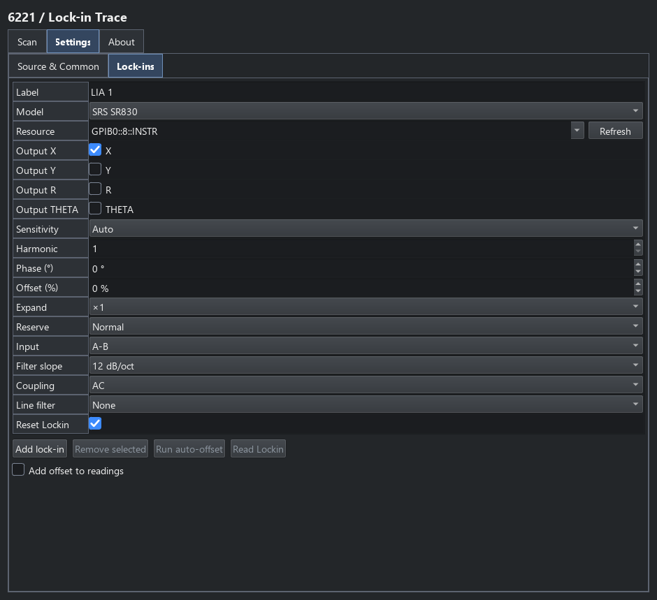

6221/lock-in trace
==================

Choose **6221/Lockins Trace** from the Keithleys catalogue for AC transport
measurements with a Keithley 6221 and one or more SRS SR830 or SIGNAL RECOVERY
7265 lock-in amplifiers. The plugin
sweeps sine-wave amplitude, DC offset or frequency and records selected
lock-in outputs at each point. It returns one shared-x trace named ``Signals``.

Source and common settings
--------------------------

**Settings > Source & Common** selects the 6221 GPIB resource and swept
parameter. **Scan** supplies that parameter's values: amperes for amplitude
or offset and hertz for frequency. Amplitude is zero-to-peak current. The
other sine-wave parameters stay at their configured fixed values.

   Source setup and settings shared by the lock-ins.

Choose the source-range policy, common time constant, read-cooldown multiple
and any auto-sensitivity thresholds. Resistance conversion optionally adds
derived channels from non-angular lock-in outputs. The 6221 phase-marker
Trigger Link output supplies a reference signal; it is not a buffered
nanovoltmeter handshake. See :doc:`keithley_triggers`.

Per-instrument settings
-----------------------

On **Lock-ins**, each column represents one instrument. Select its model,
label, GPIB resource and any combination of X, Y, R and THETA outputs. Choose
sensitivity, harmonic, phase, input, coupling, filter slope and line rejection.
The model and input mode determine the available options and physical units.
SR830 entries also support output offset, expansion and reserve settings.

   The per-instrument configuration table. Add further lock-ins as columns.

**Reset Lockin** defaults on for each instrument and controls resetting during
connect/configure. Temporary settings readback and auto-offset actions preserve
the instrument settings. Configuration allows an overload recovery interval
and reports overload that persists after the follow-up check.

Results and lifecycle
---------------------

Columns are named from the instrument labels and selected outputs; angular
outputs use degrees, while signal units follow voltage or current input mode.
Optional derived resistance channels are added to the same ``Signals`` trace.
Choose these channels in Plot Trace and Save; :doc:`data_workflows` describes
the general processing workflow.

The plugin owns the 6221 and lock-in sessions. Configuration leaves the source
output enabled; repeated measurements reuse it for fresh scans. Disconnect
turns the output off and releases the sessions. Use a point/set step instead
if later sequence children must run at a particular held DC bias.

For the Python API and console attributes, find ``Keithley6221_MultiSR830Plugin``
in the :doc:`plugin API reference <api/plugins>`.
Return to :doc:`keithley_meters` to compare trace types.
