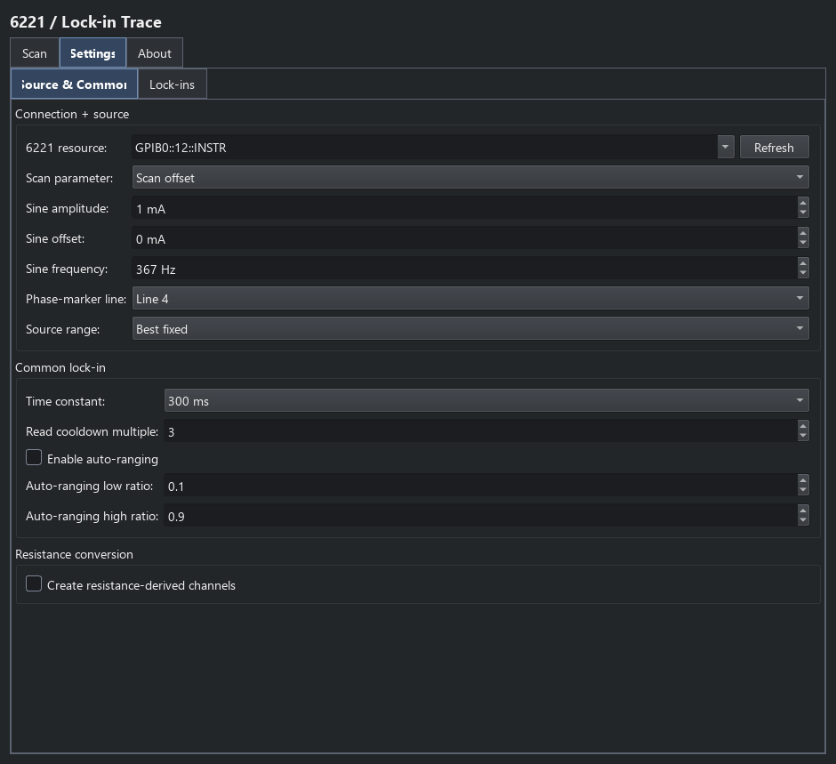
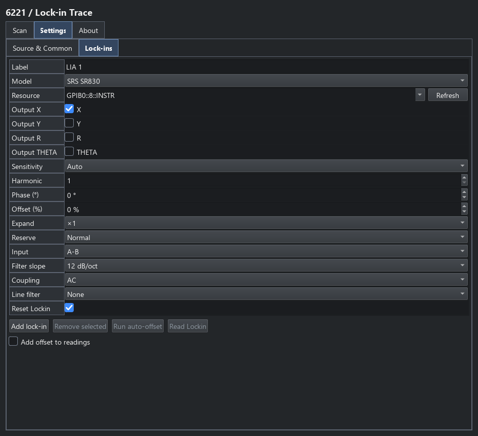

6221/lock-in trace setup
========================

See :doc:`6221/Lockins Trace </_generated/sequence_commands/plugin-k6221_multi_sr830>`
for source, instrument and output settings. Use :doc:`keithley_triggers` for
the AC reference connection between the source and lock-ins.

Source and common settings
--------------------------

   Source setup and settings shared by the lock-ins.

Per-instrument settings
-----------------------

   The per-instrument configuration table. Add further lock-ins as columns.

Give each instrument a meaningful label so that you can identify its channels
when plotting or saving the result. See :doc:`data_workflows` for that workflow.
