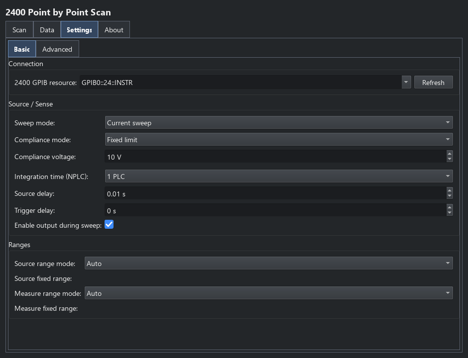
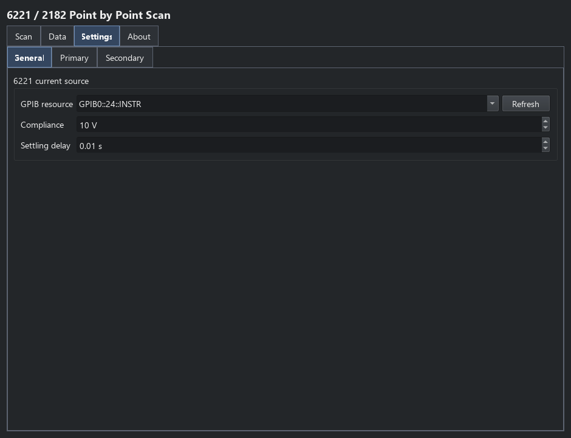
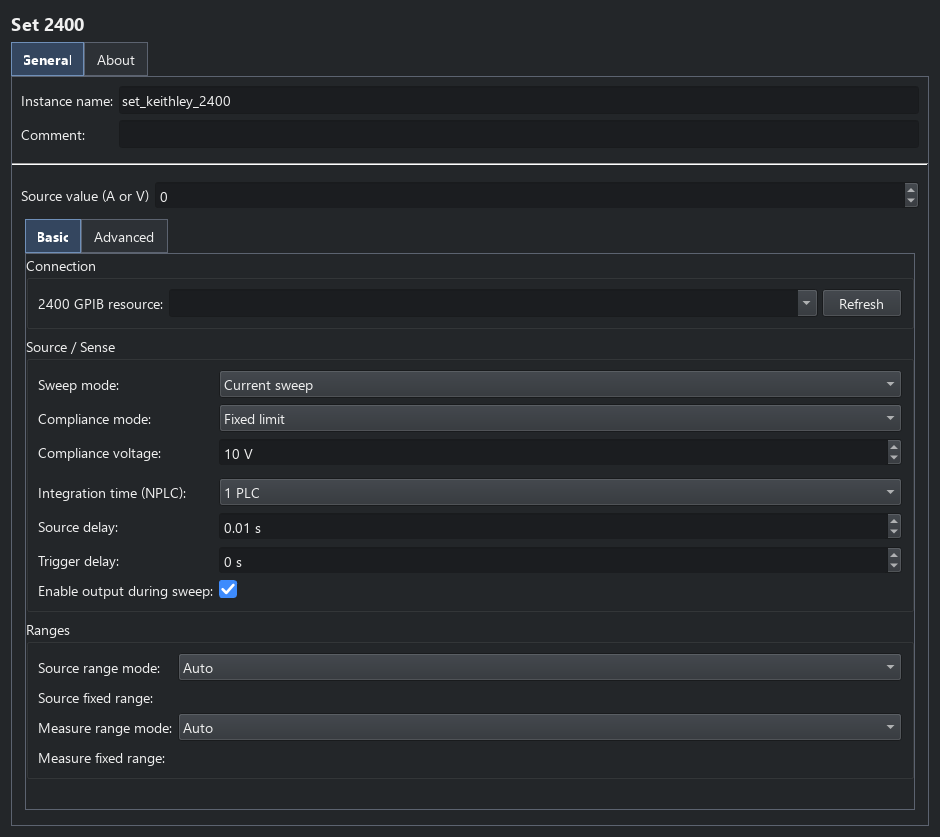
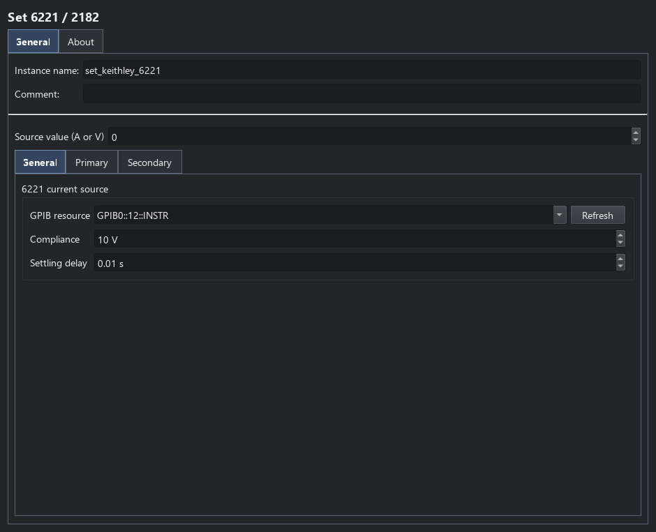

Keithley point scans and set commands
=====================================

Use a point scan for a sequence that repeats measurements at each held DC
level. Use a set step when subsequent actions share one bias. For trigger
wiring, see :doc:`keithley_triggers`. For an example with child measurements
and collected results, see :doc:`data_workflows`.

2400 point scan
---------------

See :doc:`2400 Point by Point Scan </_generated/sequence_commands/plugin-k2400_point_scan>`
for source and sense settings and scalar outputs.

   The 2400 point scan uses the instrument as one axis of a nested sequence.

For a complete buffered curve, use :doc:`keithley_2400`.

6221 DC point scan
------------------

See :doc:`6221/2182 Point by Point Scan </_generated/sequence_commands/plugin-k6221_point_scan>`
for source limits, optional-meter settings and outputs.

   Held-DC source setup; Primary and Secondary independently configure meters.

Each meter has its own integration, range, digits, trigger delay, autozero,
line synchronisation, filtering and relative-mode settings where the driver
supports them. Trigger delay and relative reference accept runtime expressions.
The 182 accepts 0.15, 1 or 5 PLC and has no independent autozero, line-sync or
filter-count control. Selecting a different secondary driver replaces
incompatible choices with that driver's defaults. Older saved configurations
load missing settings with compatible defaults.

Single set commands
-------------------

See :doc:`Set 2400 </_generated/sequence_commands/plugin-k2400_set>` and
:doc:`Set 6221/2182 </_generated/sequence_commands/plugin-k6221_set>` for their
source and meter settings. :ref:`sequence-reconfiguration` explains how to
apply different configurations at different points in a sequence.

   Set 2400 applies a single current or voltage without a scan loop.

   Set 6221/2182 holds one DC bias; either meter can remain disabled.

Trigger output while holding the 6221 DC current requires further hardware
verification. The DC point and set steps described here have not been
bench-tested. For a native Pulse Delta acquisition, see :doc:`keithley_pulse_delta`.
