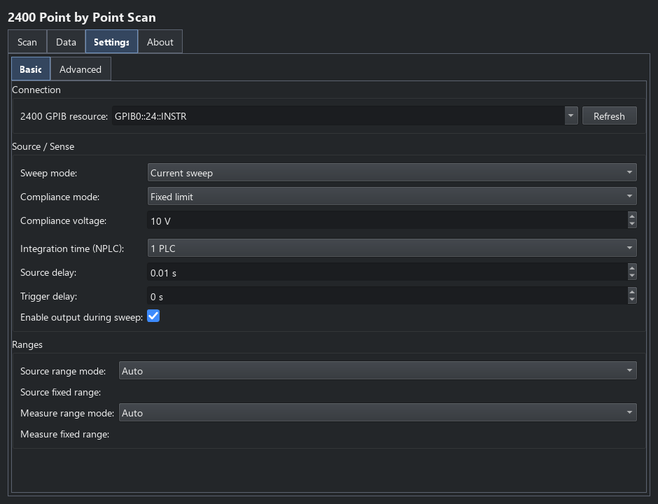
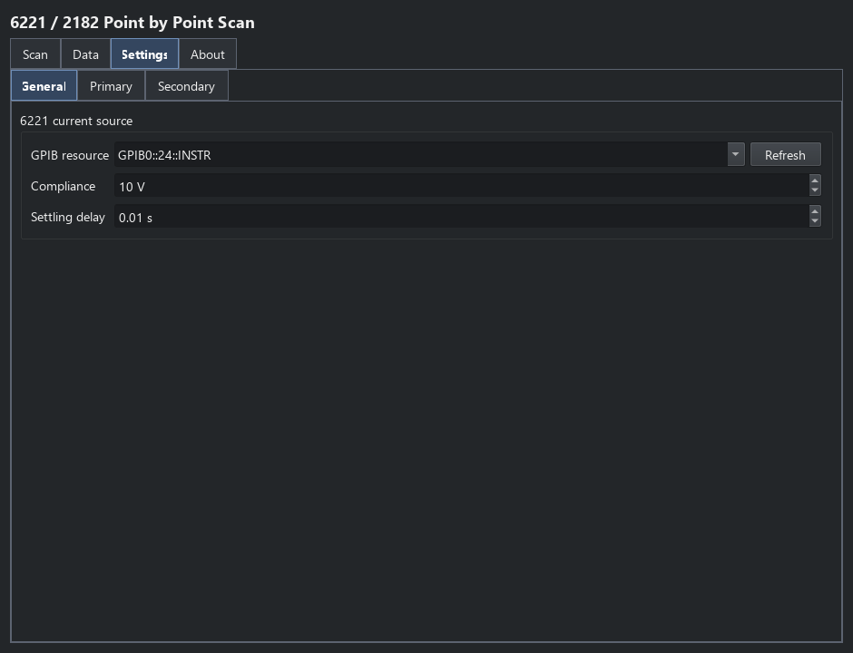
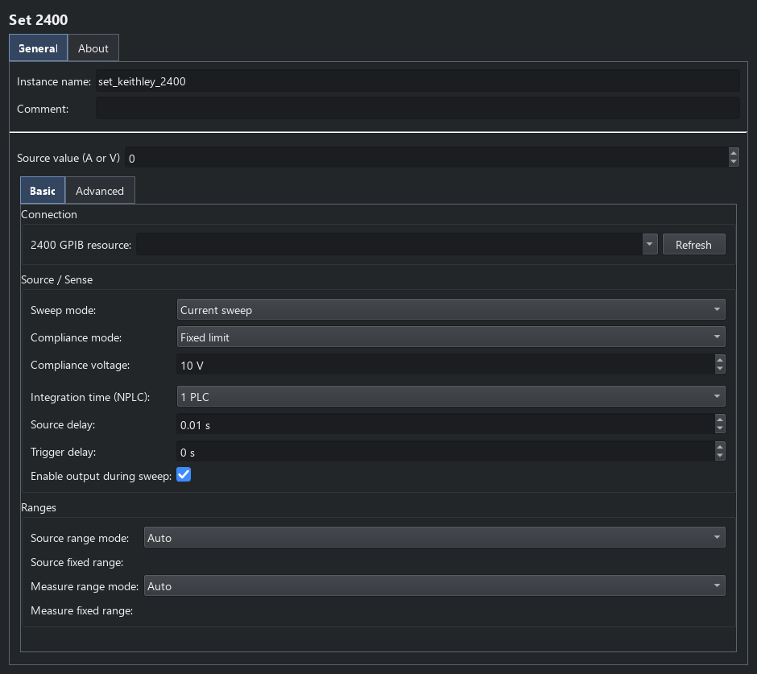
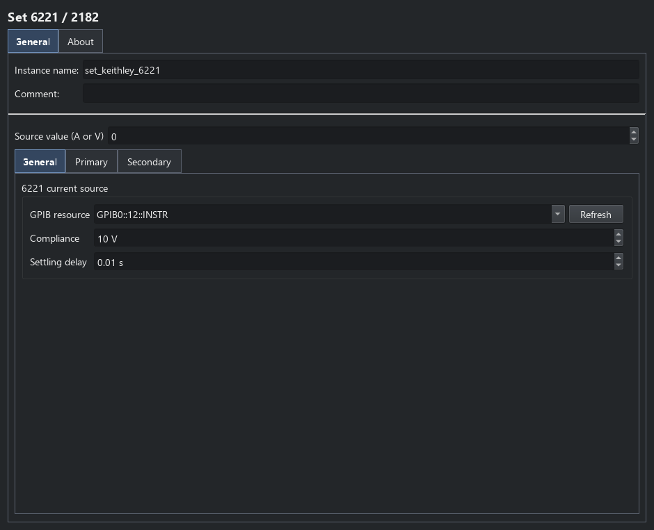

Keithley point scans and set commands
=====================================

The Keithleys catalogue includes **2400 Point by Point Scan**, **6221/2182
Point by Point Scan**, **Set 2400** and **Set 6221/2182**. This page covers their
configuration, outputs and current-holding behaviour. Use
:doc:`keithley_meters` to compare them with the four trace plugins,
:doc:`keithley_triggers` for the wiring and trigger schemes,
:doc:`data_workflows` for collection/plotting/saving, and
:doc:`third_party_plugins` for implementation contracts.

2400 point scan
---------------

Choose current or voltage sourcing, then use **Scan** to generate source
setpoints in amperes or volts. Each point directly applies one source level
and takes a reading with the configured trigger model before its nested
sub-sequence runs. It does not program an internal LIST sweep.

**Settings** contains **Basic** and **Advanced** pages. Basic selects the GPIB
resource, source mode, fixed/resistance-derived compliance, integration,
source/trigger delays, output-enable behaviour and source/sense ranges.
Advanced selects front/rear terminals, two/four-wire wiring, trigger routing,
Trigger Link input/output and filtering. See :doc:`keithley_triggers` for the
trigger-source choices.

   The 2400 point scan uses the instrument as one axis of a nested sequence.

The scalar outputs are ``source_value``, measured ``voltage`` and ``current``,
derived ``resistance`` and ``power``, and ``timestamp``. Select them for
scan-table collection or use them in child steps. With output enabled, the
source level remains available during the child sub-sequence; the next point
changes it and cleanup disables output and closes the owned session. For a
complete buffered curve instead, use :doc:`keithley_2400`.

6221 DC point scan
------------------

The scan generator supplies current setpoints in amperes. Each point sets the
6221 current, enables its output, waits for the settling delay, and reads any
enabled voltmeters. The current remains at that level throughout the nested
scan sub-sequence and until the next point or sequence cleanup.

The primary 2182A and second voltmeter are independently optional. Both start
disabled. The primary can connect directly over GPIB or through the 6221 serial
pass-through. The second meter uses its own GPIB address and may be a Keithley
182 or 2182A. Settings are arranged on **General**, **Primary**, and **Secondary**
tabs, shared by the point scan and Set 6221/2182 command. The meter tabs retain
independent enable switches, so either or both may remain disabled.

   Held-DC source setup; Primary and Secondary independently configure meters.

Each meter has its own integration time, automatic or fixed voltage range,
display digits, trigger delay, autozero, line synchronisation, digital filter
type/count, analogue filter and relative-mode reference. Trigger delay and
relative reference accept runtime expressions. Choices follow the selected
driver: for example, the 182 accepts 0.15, 1 or 5 PLC and does not expose
independent autozero, line-sync or filter-count control. Unsupported controls
are disabled. Changing the secondary driver replaces incompatible choices
with that driver's defaults. Older saved configurations load missing settings
with compatible defaults.

The scalar outputs are:

* ``source_value`` (A): the programmed current, always present.
* ``voltage`` (V) and ``resistance`` (ohms): present only with the primary enabled.
* ``secondary_voltage`` (V) and ``secondary_resistance`` (ohms): present only with
  the second meter enabled.

Resistance is voltage divided by programmed current, and is NaN at zero current.
The current is a setpoint, not a measured current. Meter reads are sequential,
not simultaneous. With neither meter enabled there are no voltage or resistance
outputs. Compliance is limited to 0.1--10.5 V, matching the existing trace
plugin's conservative limit. Current is limited to +/-105 mA.

Single set commands
-------------------

The set commands are leaf steps with a **Source value** that accepts a number or
a runtime expression on **General**. Set 2400 supports current or voltage
sourcing and reuses the 2400 point-scan compliance, wiring, range, filter and
trigger settings.
Set 6221/2182 uses the DC point-scan settings and optional-meter outputs above.

These commands connect and configure during sequence startup. Each execution
sets the source and takes the selected readings; output remains active for
subsequent steps. Sequence cleanup disables the output and closes the owned
connections. :ref:`sequence-reconfiguration` explains how to defer their setup
until a particular step.
Use one owning instance per physical source during a sequence.

   Set 2400 applies a single current or voltage without a scan loop.

   Set 6221/2182 holds one DC bias; either meter can remain disabled.

Triggering and Pulse Delta
---------------------------

The 2400 retains its existing Trigger Link output options. The 6221 DC plugin
does not emit output triggers or use its sweep/pulse model, so the programmed
current can remain applied during child steps. Trigger output without disturbing
DC current requires further hardware verification. A separate native Pulse Delta
trace is implemented; see :doc:`keithley_pulse_delta`. It does not change this
point scan's held-DC contract. No bench validation has been performed for the
DC point/set plugins documented here.
