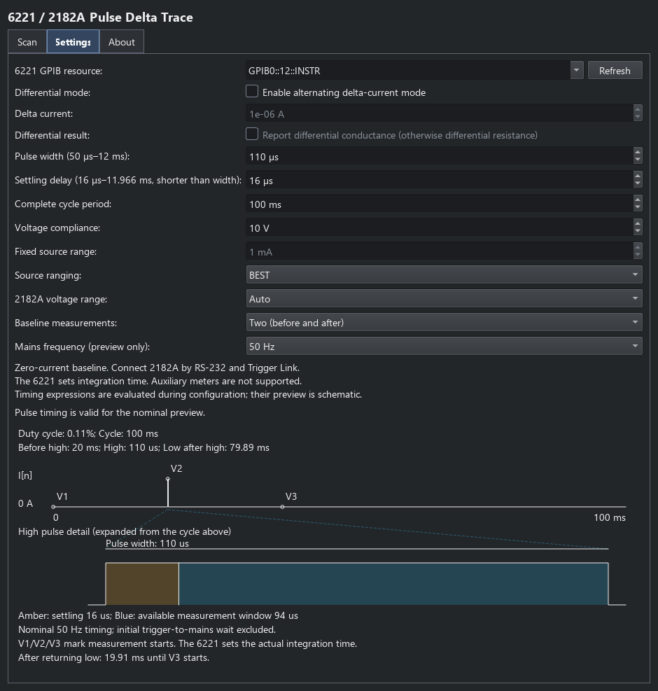

6221/2182 Pulse Delta trace
===========================

This user reference covers wiring, pulse configuration and returned data for
the native Pulse Delta acquisition. Use :doc:`keithley_meters` to compare all
four Keithley trace plugins, and :doc:`keithley_triggers` for their different
wiring and trigger schemes. For held DC during nested measurements,
use :doc:`keithley_point_commands`. For processing and saving returned traces,
see :doc:`data_workflows`.

Select **6221/2182 Pulse Delta Trace** from the Keithleys catalogue to acquire
a custom current list using the 6221's native Pulse Delta mode. **Scan** selects
the high pulse currents using the same generators as the ordinary IV trace.

Connection
------------

Connect the 2182A to the 6221 using both RS-232 and Trigger Link, with the
factory Trigger Link assignments. Set both serial interfaces to 19.2 kbaud,
with no flow control, and select GPIB for communication between the PC and 6221.
The plugin owns one GPIB session to the source.

Timing controls
----------------

**Settings** contains pulse width, settling delay within the pulse, complete
cycle period, and one or two baseline measurements. The live diagram shows
the complete cycle at its true time scale, with a linked, expanded pulse detail.
It reports duty cycle, delay before the high pulse and low time after it.
It also reports the delay from the falling edge to the final baseline reading;
disabling that reading leaves the physical cycle timing unchanged.
The **Mains frequency (preview only)** selector chooses the 50/60 Hz assumption;
it does not change the instrument's mains configuration. Timings are nominal,
measured from the first low pulse, and exclude initial trigger synchronisation.
A cycle too short for the nominal mains-spaced sequence shows an explanation
instead of an impossible waveform. Timing expressions
are evaluated during configuration, and are not evaluated by the preview.
The 6221 sets the 2182A integration time; there is no independent NPLC control.

   Native Pulse Delta settings and the linked full-cycle/pulse-detail preview.

Results and acquisition lifecycle
----------------------------------

The baseline is zero current. With two baseline measurements, voltage is
``Vhigh - (Vbefore + Vafter)/2``; with one, it is ``Vhigh - Vbefore``.
The ``IV`` trace contains current, corrected voltage, resistance and peak power.
Resistance is NaN at zero current. Power is not averaged over the cycle.

**Differential mode** optionally alternates positive/negative **Delta current**
offsets about the nominal high-pulse currents, retaining the zero-current
baseline. It requires at least three points and a positive delta current.
After the native baseline correction, neighbouring readings are reduced to
voltage and differential resistance, or conductance when selected. The source
axis stays nominal; the response column becomes ``R`` or ``G`` and power uses
delta current times the reduced voltage change. Endpoint responses use the
nearest interior reduction. This extra modulation does not replace the native
pulse timing or baseline handshake.

Native Pulse Delta has a dedicated source/meter handshake. Auxiliary meters
are not supported by this plugin: listening to its triggers would require
separate timing and measurement validation. Use the ordinary IV plugin for
its supported auxiliary-meter acquisition modes.

Configure arms the sweep. Each measurement acquires one current list, reads
the corrected voltages from the 6221 buffer, and aborts to zero/off. Further
measurements re-arm the configured list. Disconnect closes the source session.

See the `Keithley reference manual
<https://download.tek.com/manual/622x-901-01%20(C%20-%20Oct%202008)(Ref).pdf>`_,
sections 5-32 to 5-50 and 6-16 to 6-18, for instrument operation.
