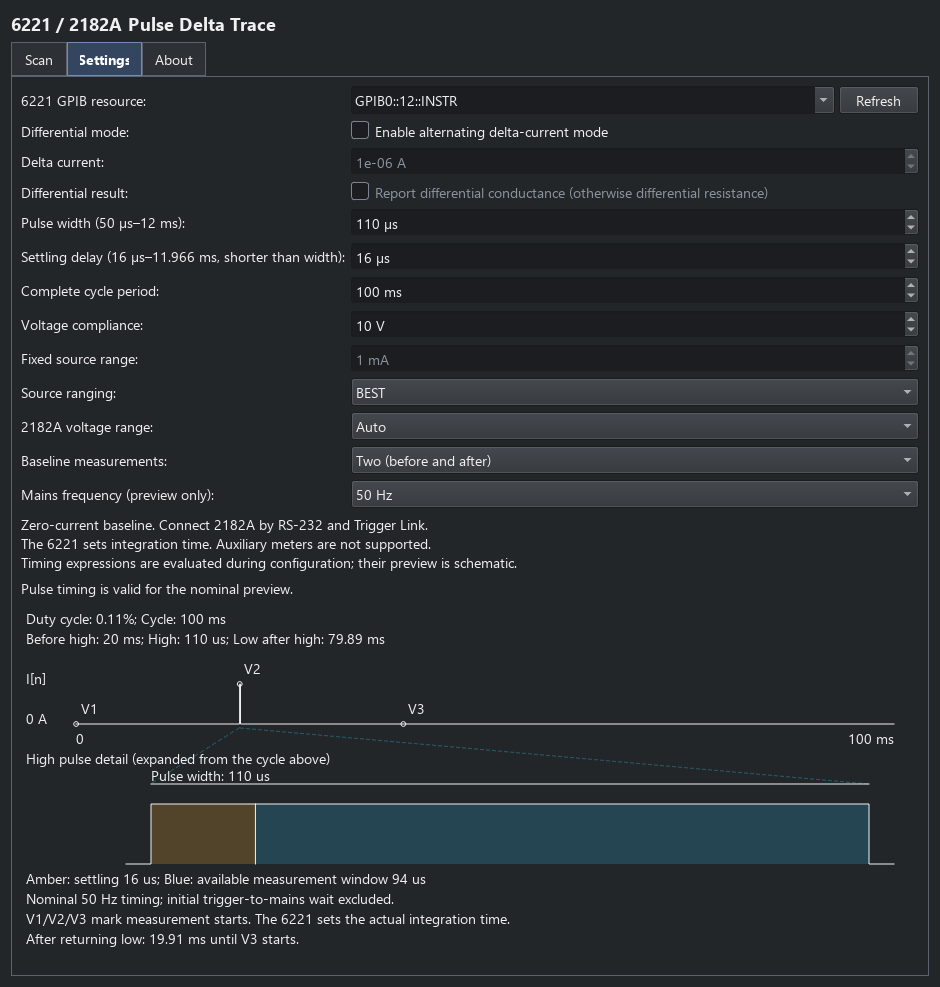

6221/2182 Pulse Delta setup
===========================

See :doc:`6221/2182 Pulse Delta Trace </_generated/sequence_commands/plugin-k6221_pulse_delta>`
for pulse settings, baseline subtraction and returned columns.
:doc:`keithley_triggers` gives the RS-232 and Trigger Link wiring and settings
for native Pulse Delta. Use :doc:`keithley_point_commands` for held DC during
nested measurements.

Timing preview
--------------

   Native Pulse Delta settings and the linked full-cycle/pulse-detail preview.

Use the expanded pulse diagram to check settling time within the high pulse.
The full-cycle diagram shows the delay from the falling edge to the final
baseline reading. Disabling that reading leaves the physical cycle timing
unchanged. Check the nominal timing against the instrument before using the
preview to plan another measurement.

See the `Keithley reference manual
<https://download.tek.com/manual/622x-901-01%20(C%20-%20Oct%202008)(Ref).pdf>`_,
sections 5-32 to 5-50 and 6-16 to 6-18, for instrument operation.
