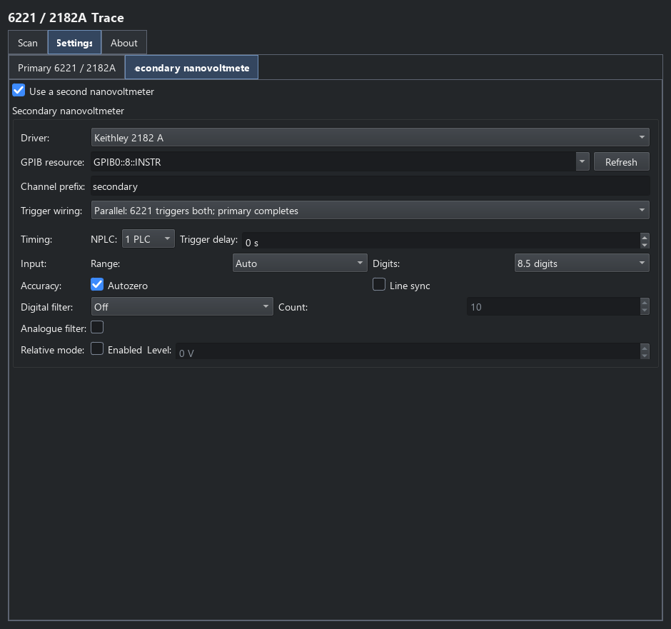

Keithley connections and triggering
===================================

Choose the acquisition mode before wiring triggers. The four trace plugins
use different coordination schemes; a GPIB address or serial relay selects a
command path, while Trigger Link or a reference cable carries timing signals.
Return to :doc:`keithley_meters` for the measurement choices.

6221/2182A buffered I-V
-----------------------

The ordinary :doc:`keithley_6221_2182a` trace programs a 6221 current list.
After settling at each point, the source triggers the primary 2182A; its
meter-complete response permits the next source step. Both buffered meter
readings and source progression must complete before the trace is returned.

The primary settings expose the two Trigger Link lines:

* **6221 to 2182A**: source output to primary-meter external trigger input
  (default line 2).
* **2182A to 6221**: meter-complete output to source input (default line 1).

Selecting **Via 6221 serial port** sends meter commands through the source's
RS-232 relay. It still needs the Trigger Link connection for this handshake.
Selecting **Direct GPIB** gives the primary its own GPIB session; it does not
remove the hardware-trigger requirement.

With a second nanovoltmeter enabled, choose one topology on **Secondary
nanovoltmeter**:

* **Parallel**: the source triggers both meters; the primary alone returns
  completion to the source. The secondary must finish before the next source
  trigger. Increase settling/primary conversion time or shorten secondary
  integration/filtering when the timing warning indicates an overrun.
* **Daisy-chain**: source triggers primary, primary completion triggers
  secondary, and secondary completion advances source. Configure the
  primary-to-secondary and secondary-to-source lines to match the cable.
  Source progression then waits for both meters.

   Routing is configured with the secondary meter's conversion settings.

2400 trigger model
------------------

The 2400 buffered trace, point scan and set command expose the supported
trigger-model controls on the nested **Advanced** page.

.. list-table:: Trigger source choices
   :header-rows: 1
   :widths: 25 75

   * - Source
     - Use
   * - Immediate
     - Proceed through the instrument's configured acquisition without an
       external start signal.
   * - Bus
     - Let the plugin issue the bus trigger when starting the acquisition.
   * - External / Trigger Link
     - Wait for the corresponding external routing; configure the input line
       and provide the expected signal.
   * - Timer
     - Use the configured instrument timer interval.

The output-enable checkbox and output-line selector are separate from the
choice of incoming trigger source. Arm count, trigger-count override and
delays also affect completion. An unprovided external trigger can leave an
acquisition waiting until its timeout.

When the buffered 2400 trace enables its secondary nanovoltmeter, it configures
a dedicated SMU/meter Trigger Link handshake. The SMU's output line triggers
the meter and the meter's completion returns on the configured input line.
This acquisition chooses its own compatible counts and arm behaviour rather
than combining arbitrary manual trigger overrides. Meter integration and
filtering must fit the intended cadence. See :doc:`keithley_2400` for settings
and result columns.

6221 with lock-ins
------------------

The :doc:`keithley_lockin` trace uses a 6221 sine-wave phase marker on its
selected Trigger Link line as the external reference for the lock-ins. This
is an AC phase/frequency reference, rather than a buffered point-complete
handshake. The plugin changes the chosen source parameter, allows the
configured time-constant/cooldown settling and reads the selected outputs.
Choose the harmonic, phase and input configuration for each lock-in.

Native Pulse Delta
------------------

:doc:`keithley_pulse_delta` requires both RS-232 and Trigger Link between the
6221 and 2182A, using the native mode's factory Trigger Link assignments.
Both serial ports use 19.2 kbaud without flow control; the PC talks to the
6221 over GPIB. The source manages the pulse/meter handshake and integration.

The ordinary I-V trace's arbitrary secondary-meter routing does not apply to
native Pulse Delta. That plugin supports no auxiliary meter. Its live timing
diagram shows nominal pulse and baseline timing, with a 50/60 Hz preview
assumption; it does not change the instrument's mains configuration or verify
physical cable timing.

Held-DC point scans and set commands
------------------------------------

The 6221 point scan and Set 6221/2182 command directly set a DC level, wait for
settling, then read any enabled meters sequentially. They do not emit output
triggers or invoke LIST/Pulse Delta merely to obtain a pulse. Current remains
held while nested or later steps execute, until it is changed or cleanup
disables the source. The primary and secondary meter sessions are optional.

The 2400 point scan and Set 2400 retain their instrument trigger-model
options, including Trigger Link output. They apply one source level at a
time, rather than programming a buffered source sweep. See
:doc:`keithley_point_commands` for per-point outputs and lifecycle behaviour.

For any physical rig, check the cable routing, signal compatibility,
integration/filter settings and source limits against the selected
instruments. Configuration screenshots illustrate the software controls;
they do not establish bench validation of the measurement timing.
