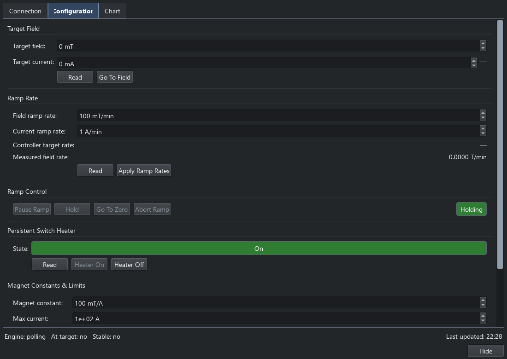

Magnet controllers
==================

The Magnet Control panel sets field or current, controls ramps and displays
readback from a shared magnet-controller engine. Open it from **Engines >
Magnet** or its toolbar button. See :doc:`rig_controls` for the common engine,
panel and status-bar connection workflow.

Connection and rig settings
---------------------------

On **Connection**, choose the driver, transport and instrument address, then
connect. **Save Settings to YAML** preserves the rig's connection settings.
The status-bar **Magnet** indicator can subsequently connect using those saved
settings without opening the panel.

**Configuration** contains the magnet constant, limits, compliance, ramp and
stability settings supported by the selected driver, alongside live controls.
Check the magnet constant and field/current conversion for the actual magnet
before applying a target. Field, current, ramp and persistent-switch options
depend on the driver and connected power supply.

   Configuration and live controls with the simulated magnet. These values
   illustrate the interface and are not settings for a physical magnet.

Manual control and monitoring
-----------------------------

Use the field/current target and ramp controls to change the state, and the
readback/status area to follow it. Persistent-switch controls are available
only when the driver supports them. **Chart** shows the controller's live
history; closing or hiding the panel leaves the shared engine connected.
Use **Disconnect** on the connection page or the main-window status indicator
when you intend to end the session.

Sequences and results
---------------------

**Set Field**, **Magnet Controller Scan**, **Magnet Controller Sweep** and
**Magnetic Field Monitor** borrow the same controller service. Use a scan to
measure after discrete targets; use a sweep to sample while the field changes.
Configure the step's data collection and plotting as shown in
:doc:`data_workflows`. The panel's chart does not itself create a saved
measurement table.

For scripted control, use the shared controller service described in
:doc:`console_api` and its signatures in :doc:`api/core`. Plugin authors must
preserve borrowed-session ownership; see :doc:`third_party_plugins`.
