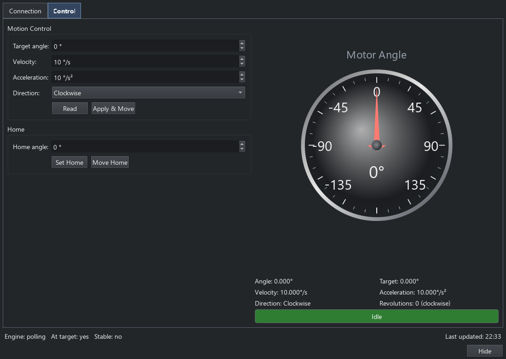

Motor controllers
=================

The Motor Control panel operates an angular stage through a shared controller
engine. Open it from **Engines > Motor** or its toolbar button. The common
connection and engine lifecycle is described in :doc:`rig_controls`.

Connection
----------

**Connection** selects the driver and its supported transport. Depending on
the driver, supply a serial port, VISA/GPIB resource, network endpoint, or
Kinesis controller serial number. The built-in simulator uses the null
transport for hardware-free operation. Set the polling rate here; **Disabled**
retains the connection while stopping automatic reads.

Connect from this page, then use **Save Settings to YAML** to retain the rig's
settings. The main-window **Motor** status indicator also offers Connect and
Disconnect using the saved settings.

Movement and readback
---------------------

**Control** provides target angle, velocity, acceleration, direction, explicit
reads and the movement operations advertised by the driver. Homing and
direction behaviour depend on the controller. The dial displays readback;
dragging it does not command movement.

   Motor controls with the built-in simulated stage.

Hiding the panel leaves the stage session connected. Disconnect explicitly
when finished, and check actual travel limits and movement directions on the
rig before using a new hardware configuration.

Sequences and results
---------------------

**Set Position**, **Motor Controller Scan**, **Motor Controller Sweep** and
**Motor Angle Monitor** share the same controller session. A scan runs its
measurement sub-sequence at discrete positions; a sweep collects while the
state changes. The simulator supports motion-profile checks without a stage.

Use :doc:`data_workflows` to collect, plot and save the selected scalar outputs.
For direct Python control see :doc:`console_api` and :doc:`api/core`.
