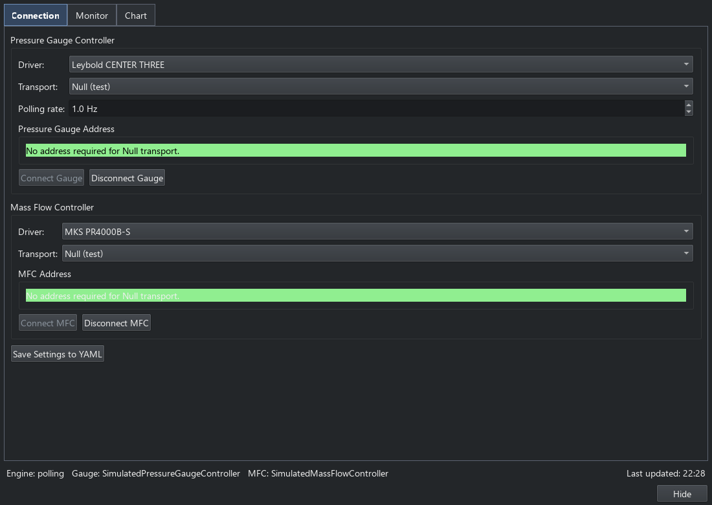
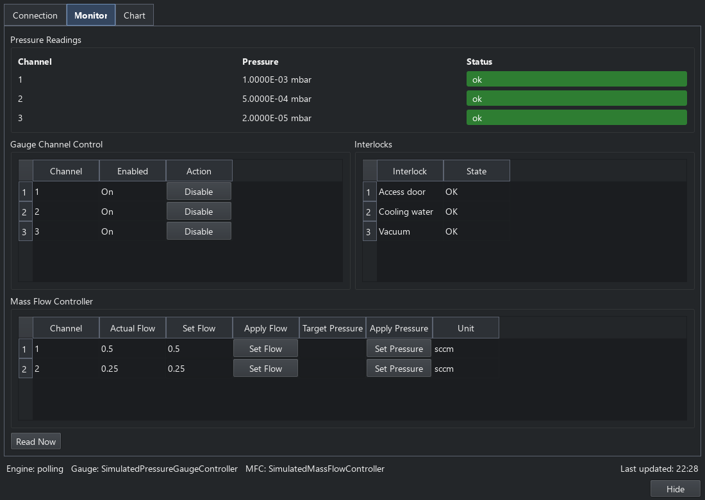

Pressure and flow controllers
=============================

The Pressure Control panel combines gauge readings and mass-flow control in a
shared engine. Open it from **Engines > Pressure** or its toolbar button.
:doc:`rig_controls` explains the common engine and status-bar controls.

Gauge and mass-flow connections
-------------------------------

**Connection** has separate instrument sections for the pressure controller
and optional mass-flow controller. Choose the driver, transport and address
for each device. Their sessions are independent; **Save Settings to YAML**
persists both sets of preferences.

   The two connection forms, shown with simulated instruments.

The main-window **Pressure** indicator connects or disconnects the preferred
pressure gauge. It leaves the independent mass-flow session unchanged. Use
the panel's mass-flow connection controls to connect or disconnect that device.
Disabling polling retains the connections and permits explicit reads.

Channels, flow and monitoring
-----------------------------

**Monitor** shows the gauge channels and available channel controls, flow
setpoints and actual flow, plus any interlocks or remote controls advertised
by the selected devices. A pressure read and a flow setpoint are different
operations: choose the device and channel that own the required capability.
Units and optional controls follow the selected driver.

   Channel monitoring and flow controls with the built-in simulators.

**Chart** keeps a live history of pressure and flow; pressure uses a logarithmic
axis. Hiding the panel leaves the engine and connected instruments running.
The panel's live chart is separate from saved sequence results.

Sequences and results
---------------------

**Pressure Monitor**, **Set Flow** and **Gauge Channel** steps borrow the shared
pressure service. Their output and channel selectors determine which readings
participate in a measurement. Use Plot Points for current scalar values, or
enable scan/sweep data collection to retain them in a result table. Save then
writes that table; see :doc:`data_workflows`.

Python access and extension contracts are covered by :doc:`console_api`,
:doc:`api/core` and :doc:`third_party_plugins`.
