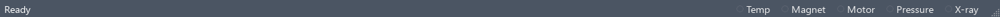

Controllers
===========

Controllers maintain the rig's temperature, magnetic field, motor position,
pressure/flow and X-ray diffractometer state alongside a measurement sequence.
Each subsystem has a background engine, an operator panel and sequence steps
that share its service. Use this page for the common workflow, then choose the
reference for the controller you are operating.

.. toctree::
   :maxdepth: 1

   temperature_controllers
   magnet_controllers
   motor_controllers
   pressure_controllers
   xray_diffractometer

Engine, panel and sequence
--------------------------

The **controller engine** owns its instrument session, dispatches automatic
polls to a worker and publishes readback, status and stability information.
The **control panel** edits the connection and operating settings and displays
that state. Related set, scan, sweep and monitor plugins borrow the shared
service; they do not own or close its sessions during sequence cleanup.

Open a panel with its toolbar button or the appropriate **Engines** submenu:
Temperature, Magnet, Motor, Pressure or X-ray. Preferences controls whether
that feature, its status indicator and its sequence plugins are visible.
Closing a panel or pressing **Hide** leaves the engine running. Stopping a
measurement sequence is also separate from disconnecting a shared controller.

Connect from the panel
----------------------

1. Open **Connection** and select the driver, a supported transport and its
   address. Driver capabilities determine which optional controls appear.
2. Connect the instrument and check its readback. Use the built-in simulators
   to explore the interface without hardware; see :doc:`simulated_instruments`.
3. Use **Save Settings to YAML** to preserve the rig's connection preferences.
   These saved choices are used by status-bar Connect.
4. Choose a polling rate. **Disabled** or zero stops automatic reads while
   retaining the connection; explicit reads still communicate with the device.

The temperature panel has primary and optional secondary controller slots.
The pressure panel has separate gauge and mass-flow sessions. Their individual
connection controls are described on their own pages.

Connect and disconnect from the main window
-------------------------------------------

The main-window status bar contains **Temp**, **Magnet**, **Motor**,
**Pressure** and **X-ray** indicators for the enabled features. Hover over an
indicator for its state; its dot pulses after a successful poll. Connected/
polling states use the connected colour, errors use the error colour and
inactive states use the default colour.

   Controller indicators in the main-window status bar, shown disconnected.

Right-click an indicator for **Connect** and **Disconnect**:

* **Connect** uses the saved preferred driver, transport and address. It is
  available while disconnected or in an error state; configure and save the
  connection from the panel first.
* **Disconnect** ends the corresponding session and its device polling. It is
  unavailable for a disconnected or stopped engine. Connection failures are
  reported in a dialogue.

For **Temp**, these shortcuts address the primary controller; a connected
secondary remains independent. For **Pressure**, they address the gauge;
use the panel for the separate mass-flow connection. The controller's own
page explains these multi-device cases.

The **Stop ... Engine** action in the controller's Engines submenu shuts down
that engine and disconnects its owned devices. Use the ordinary Disconnect
controls for routine session changes. Hiding a panel is solely a visibility
operation.

Use controllers in a measurement
--------------------------------

Use a set command for a target, a scan to run measurements after discrete
points, a sweep to collect while state changes, or a monitor for scalar
readback. The specific controller pages list the available steps and any
stability or movement conditions.

Control-panel charts are live diagnostics, separate from sequence result
tables. Select outputs in the scan/sweep data controls, then use Plot Points,
Plot Trace and Save as described in :doc:`data_workflows` to retain the
measurement you need.

For direct Python access, use the public controller services in
:doc:`console_api` and the signatures in :doc:`api/core` and
:doc:`api/instruments`. The sequence engine namespace is not itself an
instrument controller. Plugin authors must preserve shared-service ownership;
see :doc:`third_party_plugins`.
