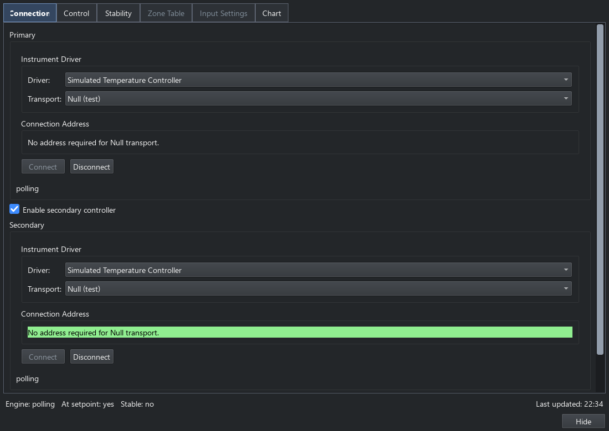
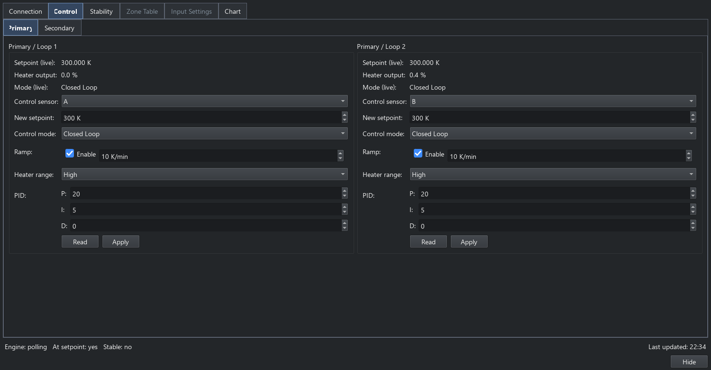
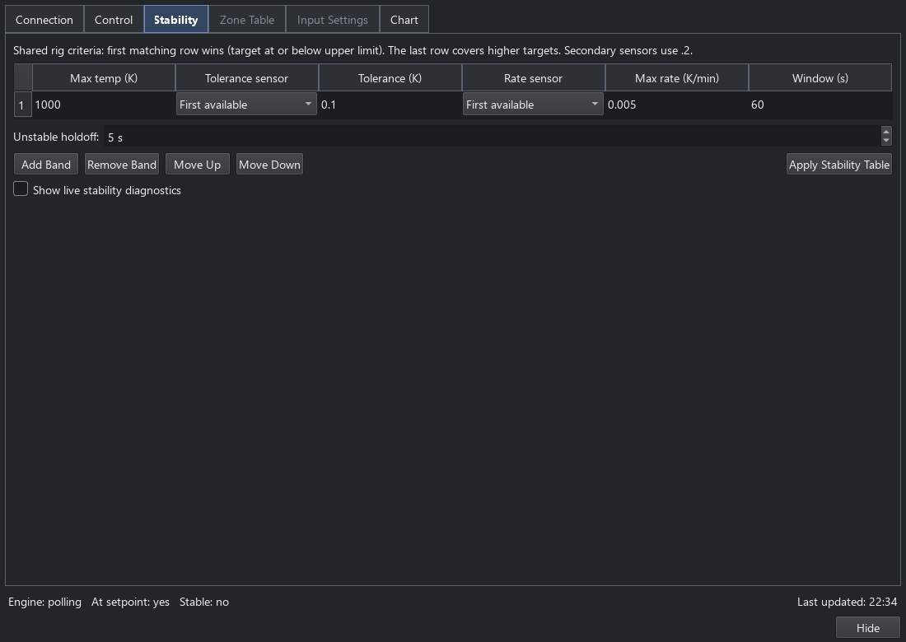

Temperature controllers
=======================

This is the user and rig-administrator reference for the Temperature Control
panel, loop selections and shared stability settings. For qualified Python
calls see :ref:`temperature-console`; for plugin contracts see
:doc:`third_party_plugins`. See :doc:`rig_controls` for the common engine,
panel and main-window status-bar workflow.

A rig can use one temperature controller or a primary controller plus an
optional secondary controller. The secondary controller is disabled by default.
Existing single-controller settings and sequences continue to select primary.

Connecting instruments
----------------------

Open the Temperature Control panel. The Connection tab has a Primary connection
form and an **Enable secondary controller** switch. Enable the switch only for
a rig with a second controller, then select its driver, transport and address.
Each instrument has independent Connect and Disconnect buttons. A secondary
instrument can remain connected when the primary is disconnected.

   Independent connection forms, shown with built-in simulated controllers.

The main-window **Temp** indicator's Connect and Disconnect shortcuts address
the primary slot. Use the panel's secondary controls to change the secondary
connection; disconnecting primary does not disconnect secondary.

**Save Settings to YAML** saves both connection forms, including settings for
an instrument that has not yet been connected. Disabling secondary disconnects
it while retaining its saved settings. The shared polling rate applies to both
instruments; zero disables automatic polling. Immediate reads still work.

The service rejects using the same physical connection in both slots. Different
instances of the simulated temperature controller can be used for testing.

Loops, sensors and settings
---------------------------

The Control page has Primary and Secondary tabs, each showing that controller's
loops side by side. The Secondary tab is hidden while secondary is disabled.
Loops are labelled by controller and native loop number. A loop's control-sensor
list contains only inputs supported by that loop on its own instrument. Identical names such as channel A or loop 1 remain
distinct on the two controllers. Disconnecting or replacing one controller does
not renumber the other controller's loops.

Zone-table selectors include the owning controller. Input settings and calibration
curve names are kept in separate labelled tables on the same page. Cryogen controls
appear for each instrument that supports them. Heater ranges and other optional
features belong to the selected instrument.

For a **Lake Shore 340**, Input Settings provides native controls for each A/B
input, including input enable, sensor type, excitation, voltage range,
compensation, filtering and calibration curve. It works in either controller
slot. Use **Read All** to load the hardware settings before writing.

Choose a sensor preset to let the instrument select its associated units,
coefficient, excitation and range. Choose **Special** to edit those values
directly. Compensation retains the separate **Off**, **On** and **Paused**
states. **Write All** sends only changed settings and reads them back, including
any defaults selected by a new sensor preset. After a failed write or readback,
use **Read All** before retrying. Polling does not overwrite these edits.

   Loop controls with the built-in simulator; the secondary controller has
   its own labelled tab.

The Stability page has one shared table for the whole rig. Each tolerance and
rate sensor can come from either controller: ``A`` is primary channel A and
``A.2`` is secondary channel A. An empty selection uses the first available
sensor on the rig, primary first. An explicit missing sensor, invalid reading,
failed poll or stale state cannot satisfy a stability wait. A controller's
failure also invalidates any peer loop whose criteria depend on its readings.
Both controllers are read before stability is evaluated.

Rows are evaluated in their displayed order against each loop's target setpoint.
The first row whose upper temperature limit includes the target wins, even when
another row also matches. Use **Move Up** and **Move Down** to choose priority;
rows are never automatically sorted. If no row matches, the last row applies.
Changing the selected band or sensor starts a fresh stability window.

   One ordered stability table for the whole temperature rig.

The chart combines temperature, setpoint, heater and supported gas-flow traces.
Secondary labels use the suffix ``.2``, such as ``T_A.2`` and ``SP_1.2``. Internal
trace keys retain their previous names to preserve saved styles and visibility.
Drag the divider between the plot and legend to resize them.

There is one **dT/dt** trace. It uses the engine's rate for the selected rate
sensor in the active stability band. When loops use different bands, the earliest
active table row takes priority; ties use primary before secondary, then increasing
loop number. Hover over its legend label to see the chosen sensor. Sensor changes
clear the rate history to avoid joining unrelated measurements. Missing or invalid
selected data clears the trace and displays ``Unavailable``.

Sequences and console use
-------------------------

Set Temperature, Temperature Controller Scan and Temperature Controller Sweep
use a controller-labelled loop selector. Saved selections remain visible as
unavailable while disconnected. A missing secondary target never selects primary
instead. Scan/sweep limits come from the chosen controller.

Sensor and monitor-loop lists have catalogue pickers. Editable lists accept
``A, secondary:A`` for sensors and ``1, secondary:1`` for loops. Unqualified
entries mean primary. An empty sensor list includes all available sensors.
The monitor leaves the shared controller connections running when it stops.

For controller-qualified Python calls and state inspection, see
:ref:`temperature-console`. Legacy unqualified loop numbers and sensor names
continue to mean primary; use qualified references for the secondary device.

Make Safe attempts output shutdown on every advertised loop of both connected
controllers, including after a failure on the first. Stopping the temperature
engine attempts to disconnect both. These operations report failures; they do
not substitute a different target or claim successful writes after an I/O error.

Configuration compatibility
---------------------------

The machine YAML uses ``schema_version: 3`` with separate connection settings in
``controllers.primary`` and ``controllers.secondary``, and one top-level
``stability`` table. Stability sensor keys retain ``secondary:A`` internally;
``.2`` is their compact display suffix.

Older per-controller stability settings migrate using the primary table as the
shared table. An explicit version 3 top-level table takes precedence. Existing
single-controller settings and timestamped backups remain supported. Review the
shared table when migrating a rig that previously used different secondary
criteria.

Old sequence loop numbers and sensor strings mean primary. New command and state
plugin JSON includes ``controller_id``. Mixed monitor and sensor selections store
structured references. Sequence JSON and saved-data sequence metadata retain
those identities. Two-controller sequences require a release supporting this
schema; older releases cannot be expected to read them.

Timer-driven polling is dispatched to a controller worker so device I/O does
not block the GUI event loop. Shared-state reads still need controller data;
a slow or failed instrument can delay fresh readings and invalidate dependent
stability criteria. Transport timing, actual sensor assignments and output shutdown must
be checked on the measurement rig before relying on a new hardware configuration.
