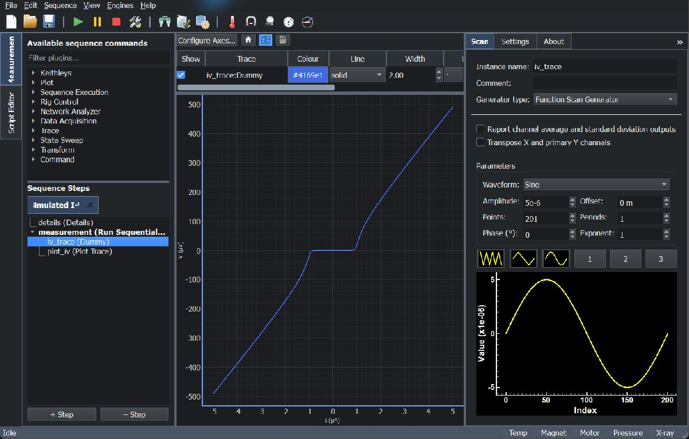
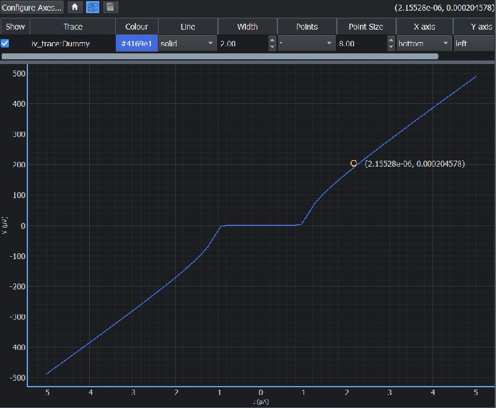
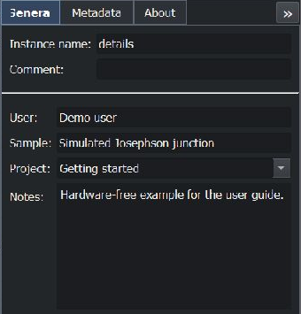
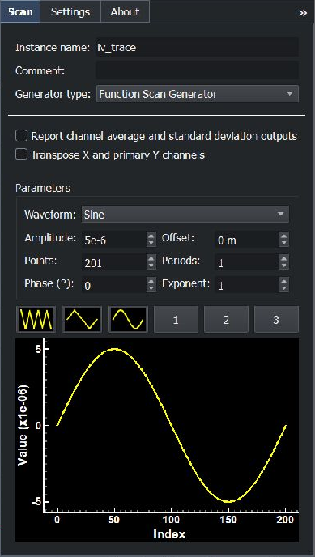
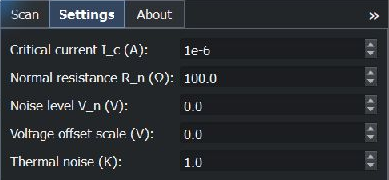
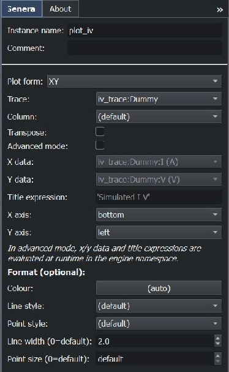
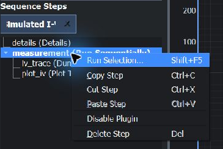
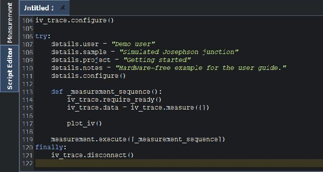

Usage
=====

This is the introductory guide for new users building and running their first
measurement. No Python or connected hardware is needed for the worked example.
The measurement-reference and developer paths cover advanced operation and
implementation contracts separately.

Starting the application
------------------------

On Windows, release packages include an offline manual. Choose
**Help > User Guide**, or press **F1**, to open it in Windows Help Viewer.
The bundled guide works without an internet connection; links to external
documentation still require internet access.

After installation, launch the application from the command line:

.. code-block:: bash

    stoner-measurement

Or from Python:

.. code-block:: python

    from stoner_measurement.main import main
    main()

Application layout
------------------

The main window is split into three panels:

* **Left panel (25 %)** — Available steps and sequence builder. Drag commands,
  measurements and containers into the sequence to define the procedure.
* **Central panel (50 %)** — Live measurement display. Plot Points and Plot
  Trace steps send selected results here during execution.
* **Right panel (25 %)** — Configuration tabs for the selected sequence step.

   A completed hardware-free measurement. Select a sequence step to display
   its configuration on the right; drag the panel dividers to adjust the layout.

The illustrations below use the application's dark theme. Choose the theme
in **Edit → Preferences…**. The same controls are available in the light theme.

Mouse control and data markers
~~~~~~~~~~~~~~~~~~~~~~~~~~~~~~

Click an axis to toggle whether mouse panning and zooming affect it. Active
axes have a highlighted, slightly thicker spine; left and bottom start active.
Each axis can be selected independently, including multiple axes on the same
side. Selected axes retain their own scales and ranges while moving together.
With all axes inactive, mouse gestures leave the plot ranges unchanged.

The pointer readout and automatic data-marker labels show only active axes.
Right-click the plot and choose **Add Data Marker** to pin a marker to the
first active x axis and first active y axis (default axes first, followed by
additional axes in creation order). Marker placement requires at least one
active axis in each direction. Existing markers retain their original data
coordinates and axis pair when selection changes; their automatic labels
update to show the currently active coordinates. Explicit marker labels are
preserved. Removing an axis also removes markers anchored to it.

   Right-click a plot position and choose **Add Data Marker** to label it.
   Here the configuration panel is collapsed to give the plot more room.
   The table above the plot controls trace visibility, colour, line style,
   and axis assignment.

Building and running a sequence
--------------------------------

1. Select an instrument in the **left panel** and click *Add Step*.
2. Repeat for each step you need.
3. Configure each step via the corresponding tab in the **right panel**.
4. Click *Run* to start the sequence.

Try a measurement without hardware
~~~~~~~~~~~~~~~~~~~~~~~~~~~~~~~~~~

Download :download:`the simulated I-V sequence <examples/simulated_iv.json>`
and open it with **File → Open Sequence…** while on the **Measurement** tab.
It uses the built-in **Dummy** trace plugin, which simulates a Josephson
junction without connecting to an instrument. The ``measurement`` container
runs its two children in order: ``iv_trace`` acquires the data, then
``plot_iv`` displays it.

Select ``details`` and fill in **User**, **Sample**, and **Project** on its
**General** tab. These required fields identify the measurement; an empty
field prevents the sequence from continuing. The example supplies demonstration
values, which you can replace with your own.

   Complete the Details step before running a sequence that includes it.

Select ``iv_trace``. Its **Scan** tab defines the current values to measure.
This example uses a sine waveform with amplitude ``5e-6`` A, 201 points,
and one period. The preview shows the order of the current values, rather
than the measured voltage.

   Scan controls and preview for the simulated current sweep.

On the **Settings** tab, set the critical current to ``1e-6`` A and the
normal resistance to ``100`` ohms. The voltage noise and voltage offset
scale are both zero in this example.

   Model settings determine the simulated junction's response.

Select ``plot_iv`` and check that **Plot form** is **XY** and **Trace** is
``iv_trace:Dummy``. Leaving **Column** on **(default)** uses the trace's
default dependent columns; advanced expressions are unnecessary for this
example.

   The Plot Trace command displays the data acquired by the preceding step.

Click **Run** or press :kbd:`F5`. After the status returns to **Idle**, the
central plot shows the simulated I-V characteristic, as in the workspace
illustration above. Use **Pause** (:kbd:`F7`) and **Stop** (:kbd:`F6`) for
longer sequences. Save the configured sequence with :kbd:`Ctrl+S` to reuse it.

.. _running-selected-steps:

Running selected steps
~~~~~~~~~~~~~~~~~~~~~~

To check part of a measurement, select one or more steps in the sequence
tree, right-click the selection and choose **Run Selection...**, or press
:kbd:`Shift+F5`. The selected steps run in sequence order as a one-off script.
Selecting a container such as an if, scan or sweep includes its complete
sub-sequence. Children of a
selected ancestor are included only once. Selecting a child on its own runs
that child without its enclosing container or unselected siblings.

The script uses the usual connection, configuration and cleanup behaviour.
Include any setup steps required by the selection. Pause and Stop work as
they do for a full sequence.

On successful completion, the temporary script tab is discarded without
saving. If execution fails or is stopped, the script remains in the Script
Editor for inspection. A temporary script that you edit or save is also kept.
The source sequence and existing script tabs are preserved.

   Selecting ``measurement`` runs both acquisition and plotting. The Details
   step is outside this selection, so it is not executed by this one-off run.

Inspecting the generated script
~~~~~~~~~~~~~~~~~~~~~~~~~~~~~~~

Click **Generate Code** on the toolbar or in the **Sequence** menu, then
open the **Script Editor** tab on the left. Code generation from the
Measurement tab updates the editor in the background. The script contains
the configured steps, including the nested acquisition and plotting actions
and the cleanup that disconnects the trace plugin.

   The action block at the end of the generated example script. The earlier
   part of the script constructs and configures the plugins.

On the Script Editor tab, :kbd:`F5` runs the current script. You can edit
and save it independently of the sequence. The console below the editor
shows execution messages and supports interactive inspection of results.

More complete measurement workflows
------------------------------------

See :doc:`data_workflows` for an illustrated scan/sweep workflow covering
output selection and column roles, filtering, curve fitting, Plot Points,
Plot Trace, complete-trace saving, and incremental saving of a growing table.
It includes a downloadable hardware-free example based on a predefined
toolbar sequence.

Next steps
-----------

For reference while developing a measurement, use :doc:`sequence_execution`,
:doc:`plot_displays`, :doc:`configuration`, and :doc:`console_api`.
:doc:`trace_data` explains the result tables behind plotting and saving.
To implement a new plugin rather than operate one, follow
:doc:`third_party_plugins`.
