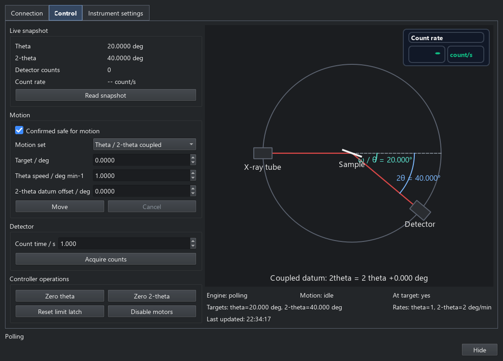

X-ray Diffractometer Control
============================

The X-ray control panel operates a legacy two-axis diffractometer and scalar
detector counter. Open it from **Engines > X-ray**. The panel supports a native
FTDI USB instrument labelled **Wharfedale**, and a built-in simulator.
This page is for operators configuring and using that rig. Use
:doc:`data_workflows` for general collection/plotting/saving and
:doc:`third_party_plugins` for extension contracts.
The shared engine, panel and status-bar workflow is introduced in
:doc:`rig_controls`.

Safety and first connection
---------------------------

Motion is disabled by default. The bundled configuration contains recovered
values from the original installation, not universal hardware limits:

* theta: -90 to +90 degrees, 400 steps per degree;
* 2-theta: -30 to +90 degrees, 200 steps per degree;
* backlash: 100 theta steps and 50 2-theta steps (0.25 degrees on each axis).

Before selecting **Confirmed safe for motion**, verify those limits, the
backlash values, both single-step directions, and the available mechanical
clearance on the current instrument. First communication tests should use
**Read snapshot** with the motors and X-ray source safely inhibited.

Wharfedale connection
---------------------

Identify the FTDI USB device by zero-based index (for example ``index:0``) or
FTDI serial number (for example ``serial:FT123456``). The device field changes
colour while connecting and to show connected or error state.

The connection tab also provides the same 0 to 10 Hz polling-rate control used
by the motor controller. Set it to **Disabled** to retain the connection
without automatic reads. The application status bar shows the X-ray engine
state and pulses for each successful poll; right-click its **X-ray** indicator
to connect or disconnect using the saved instrument settings.

Instrument settings lock
------------------------

The **Instrument settings** tab shows the theta and 2-theta travel limits,
steps per degree, backlash, datum offset, motion speed, connection timeout,
polling rate, and default count time. These controls are read-only until an
experienced operator selects **Unlock settings** and enters the code stored as
``settings_unlock_code`` in the local ``xray_controller.yaml`` file. The
bundled initial code is ``Wharfedale``.

When unlocked, the tab also shows a form for replacing the unlock code. The
new code and confirmation must match. **Apply and save instrument settings**
writes the complete configuration to the machine-local YAML file and confirms
the full path in a dialog. Selecting **Lock settings** discards unsaved edits,
disables the controls, and hides the code-reset form.

Motion sets
-----------

The panel exposes three absolute motion sets:

* **Theta only** rotates the sample stage.
* **Theta / 2-theta coupled** enforces
  ``2-theta = 2 * theta + datum offset``. The entered speed is the theta rate;
  the detector arm therefore travels at twice that angular rate.
* **2-theta only** moves only the detector arm.

Viewed from above, with the source at the left and detector at the right, the
straight-through path defines both coordinates as zero. In reflection
geometry, increasing coupled motion rotates both the theta sample stage and
the 2-theta detector arm clockwise, with the detector moving through twice the
angle. The live synoptic displays the measured sample, detector and reflected
ray geometry after every snapshot.

Counterclockwise moves overshoot by the configured backlash on each moving
axis and finish with a clockwise approach. The simulator also shows this
temporary excursion.

   Motion and counting controls with the built-in simulated diffractometer.

Detector counting
-----------------

Counting is timed by the host. The engine starts the scalar counter, waits for
the requested duration using a monotonic clock, guarantees a stop command, and
then reads a complete position/count snapshot. The panel displays both raw
counts and counts per second. The synoptic repeats the latest count rate in a
value-watch-style display at its top right, so it remains visible while a scan
is running.

Simulation
----------

Select **Simulated** to exercise the same abstract driver contract, engine and
panel without hardware. The simulator supports all three motion sets and
generates a deterministic powder-diffraction pattern with several peaks as the
2-theta arm moves. It supports the implemented scan/set/read workflow without
representing the physical response of a particular sample. Simulated movement uses
the configured real angular rate: for example, a 5 degree move at 5 degrees per
minute takes one minute while the live position and synoptic update.

Sequence plugins
----------------

See :doc:`Diffractometer Control commands </_generated/sequence_commands/group-diffractometer-control>`
for scan, set and read steps. For example, in a scan named ``xray_scan``, the
count-time expression ``0.5 + abs(xray_scan.value) / 20`` lengthens integrations
at higher angles. The control panel shows the active count time during the
scan. Enable the X-ray feature in Preferences to show its steps in the tree.
